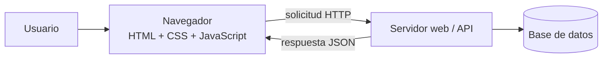
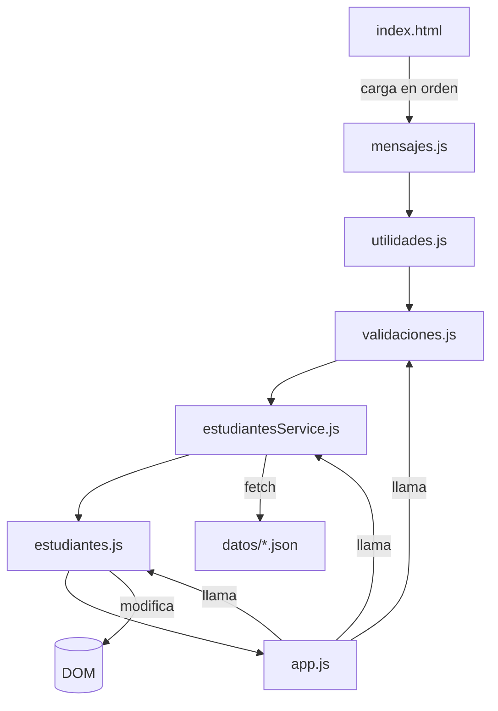
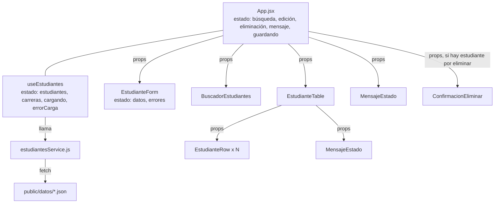
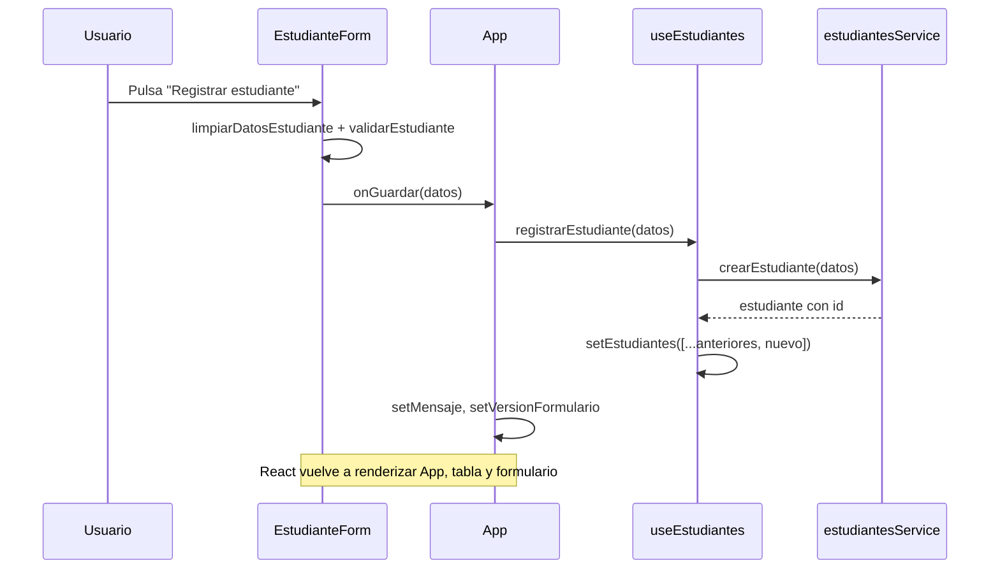
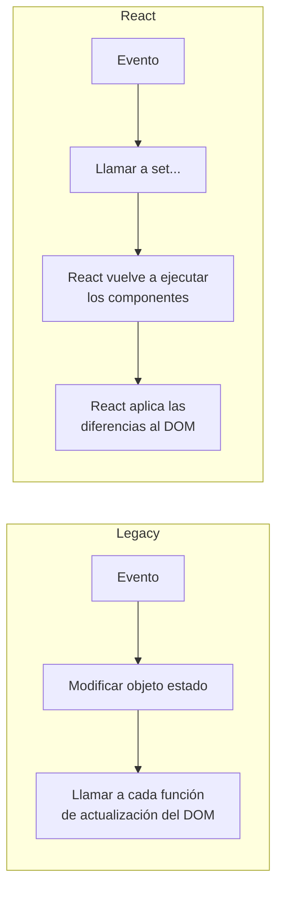
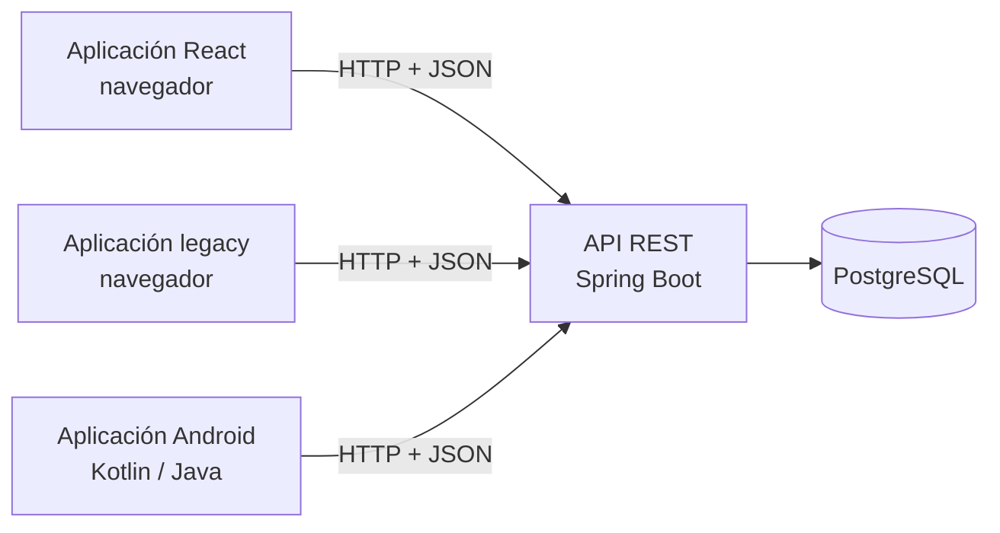

# Guía para la presentación: desarrollo web legacy frente a React

**Curso:** Desarrollo Web
**Caso práctico:** módulo de ingreso de estudiantes
**Proyectos de referencia:** `legacy/` (HTML, CSS y JavaScript tradicional) y `react/` (React 19 con Vite 6)
**Duración prevista:** 2 horas

Este documento es la fuente para preparar las diapositivas y las demostraciones de la clase. Todos los fragmentos de código marcados con **Archivo:** se copiaron del proyecto, en el orden en que aparecen. Las líneas `// ...` indican partes omitidas. Los fragmentos marcados como **ilustrativos** no forman parte del proyecto.

Convención usada en el documento:

- **Observado en el proyecto:** hechos que se pueden comprobar en este código.
- **En general:** afirmaciones sobre cada enfoque que van más allá de este proyecto.

---

## Plan de la sesión (120 minutos)

| Bloque | Tiempo | Contenido | Demostración en vivo |
|---|---|---|---|
| 1 | 10 min | Sección 1: introducción | Abrir ambas aplicaciones lado a lado: se ven y funcionan igual. |
| 2 | 25 min | Sección 2: enfoque legacy | F12 > Elementos: ver cómo cambia el `<tbody>` al buscar. |
| 3 | 30 min | Sección 3: enfoque React | React Developer Tools: ver el estado de `App` al escribir en el buscador. |
| 4 | 25 min | Sección 4: comparación de nueve tareas | Registrar, editar y eliminar en ambas; `?demora=2000` y `?error=1`. |
| 5 | 10 min | Secciones 5 y 6: arquitectura, limitaciones y evolución | Registrar un estudiante y recargar (F5). |
| 6 | 15 min | Sección 7: actividad de laboratorio (inicio) | Actividad 4 en vivo con los estudiantes. |
| 7 | 5 min | Sección 8: conclusiones | |

Preparación previa: ejecutar `npx http-server legacy -p 5500 -c-1` en la raíz del repositorio, y `npm install` seguido de `npm run dev` en `react/`. Abrir <http://localhost:5500> y <http://localhost:5173> en dos ventanas.

---

## Sección 1. Introducción al desarrollo web

### 1.1 Qué es el desarrollo web

**Definición:** construir aplicaciones que se ejecutan en un navegador (el *frontend*) y que normalmente se comunican con un servidor (el *backend*) para leer y guardar datos.

Diapositiva sugerida: diagrama cliente-servidor.



En este laboratorio solo existe la parte izquierda: el "servidor" se simula con archivos JSON (ver la sección 6).

### 1.2 HTML, CSS y JavaScript

| Tecnología | Responsabilidad | Ejemplo en el proyecto |
|---|---|---|
| HTML | Estructura y significado | `legacy/index.html`: formulario, tabla, cuadro de diálogo |
| CSS | Presentación | `legacy/css/styles.css` (el mismo archivo se copió a `react/src/styles/styles.css`) |
| JavaScript | Comportamiento | `legacy/js/*.js` y `react/src/**/*.jsx` |

**Observado en el proyecto:** las dos versiones usan exactamente la misma hoja de estilos. Lo que cambia es cómo se produce el HTML y cómo se actualiza.

### 1.3 Qué es una aplicación web tradicional

**Definición:** una aplicación en la que el programador escribe el HTML de la página y usa JavaScript para modificarla directamente a través del **DOM**.

**DOM (Document Object Model):** la representación en memoria de la página como un árbol de objetos. JavaScript puede leerlo y modificarlo (`document.getElementById`, `createElement`, `appendChild`). Cada modificación del DOM se refleja en la pantalla.

### 1.4 Qué es una biblioteca de interfaz como React

**Definición:** React es una biblioteca de JavaScript para construir interfaces a partir de **componentes**: funciones que reciben datos y devuelven una descripción de lo que debe mostrarse. React compara esa descripción con la anterior y aplica al DOM solo los cambios necesarios.

Mensaje clave para la diapositiva: **React no reemplaza a HTML, CSS ni JavaScript; los usa.** El JSX produce HTML, los estilos son CSS común y la lógica es JavaScript.

---

## Sección 2. El enfoque legacy

### 2.1 Estructura de archivos

```
legacy/
├── index.html                     Estructura completa de la interfaz
├── css/styles.css
├── js/
│   ├── mensajes.js                Textos para el usuario
│   ├── utilidades.js              Funciones puras (código, búsqueda, formato)
│   ├── validaciones.js            Reglas de validación
│   ├── servicios/estudiantesService.js   Acceso a datos
│   ├── estudiantes.js             Presentación: modifica el DOM
│   └── app.js                     Estado, eventos y coordinación
└── datos/estudiantes.json, carreras.json
```



**Observado en el proyecto:** los scripts no son módulos; comparten el ámbito global. El orden de las etiquetas `<script>` es obligatorio:

**Archivo:** `legacy/index.html`
```html
<script src="js/mensajes.js" defer></script>
<script src="js/utilidades.js" defer></script>
<script src="js/validaciones.js" defer></script>
<script src="js/servicios/estudiantesService.js" defer></script>
<script src="js/estudiantes.js" defer></script>
<script src="js/app.js" defer></script>
```

### 2.2 Construcción manual del formulario

Todo el formulario está escrito en HTML. Cada campo tiene su `label`, su `id` y un contenedor para el mensaje de error:

**Archivo:** `legacy/index.html`
```html
<div class="campo">
  <label for="correo">Correo electrónico <span class="obligatorio">*</span></label>
  <input id="correo" name="correo" type="email" maxlength="100" aria-describedby="error-correo" />
  <span id="error-correo" class="campo__error"></span>
</div>
```

Explicación: `for="correo"` asocia la etiqueta con el campo, y `aria-describedby` hace que un lector de pantalla lea también el mensaje de error. `novalidate` en el `<form>` desactiva la validación nativa del navegador para usar las reglas propias.

### 2.3 Selección de elementos del DOM

**Archivo:** `legacy/js/estudiantes.js`
```js
const dom = {
  mensajeGeneral: document.getElementById("mensaje-general"),
  formulario: document.getElementById("formulario-estudiante"),
  // ...
  cuerpoTabla: document.getElementById("cuerpo-tabla"),
  estadoTabla: document.getElementById("estado-tabla"),
  // ...
};
```

Explicación: las referencias se buscan una sola vez y se guardan. Este objeto es el **contrato** entre HTML y JavaScript: si un `id` cambia en `index.html`, hay que cambiarlo aquí.

### 2.4 Registro de eventos

**Archivo:** `legacy/js/app.js`
```js
function registrarEventos() {
  dom.formulario.addEventListener("submit", manejarEnvioFormulario);
  dom.formulario.addEventListener("input", manejarCambioCampo);
  dom.botonCancelar.addEventListener("click", manejarCancelar);
  dom.buscador.addEventListener("input", manejarBusqueda);
  dom.cuerpoTabla.addEventListener("click", manejarClicTabla);
  dom.dialogoCancelar.addEventListener("click", cancelarEliminacion);
  dom.dialogoConfirmar.addEventListener("click", confirmarEliminacion);
  document.addEventListener("keydown", manejarTeclado);
}
```

Los botones de cada fila se crean y destruyen constantemente, así que no reciben su propio evento. Se usa **delegación de eventos**: un único manejador en el `<tbody>`.

**Archivo:** `legacy/js/app.js`
```js
function manejarClicTabla(evento) {
  const boton = evento.target.closest("button[data-accion]");
  if (!boton || estado.guardando) {
    return;
  }

  // Los atributos data-* siempre son texto, por eso se convierte el id a número.
  const id = Number(boton.dataset.id);
  if (boton.dataset.accion === "editar") {
    iniciarEdicion(id);
  } else if (boton.dataset.accion === "eliminar") {
    solicitarEliminacion(id);
  }
}
```

### 2.5 Consulta de archivos JSON

**Archivo:** `legacy/js/servicios/estudiantesService.js`
```js
async function consultarJson(nombreArchivo) {
  await simularRed();
  const respuesta = await fetch(`${CONFIG_API.urlBase}/${nombreArchivo}`);
  if (!respuesta.ok) {
    throw new Error(`No se pudo leer ${nombreArchivo} (HTTP ${respuesta.status}).`);
  }
  return respuesta.json();
}
```

Términos previos para la diapositiva:

- **Promesa:** objeto que representa un resultado que estará disponible más adelante (o un error).
- **`async`/`await`:** sintaxis para esperar una promesa sin bloquear el navegador; el código se lee de arriba abajo.
- **`fetch`:** función del navegador para hacer solicitudes HTTP. Solo rechaza la promesa ante fallos de red; un 404 se detecta con `respuesta.ok`.

### 2.6 Construcción dinámica de tablas

**Archivo:** `legacy/js/estudiantes.js`
```js
function crearFilaEstudiante(estudiante, carreras, idEnEdicion) {
  const fila = document.createElement("tr");
  if (estudiante.id === idEnEdicion) {
    fila.classList.add("tabla__fila--edicion");
  }

  fila.appendChild(crearCelda(estudiante.codigo, "Código"));
  fila.appendChild(crearCelda(estudiante.nombres, "Nombres"));
  // ...
  const botonEditar = document.createElement("button");
  botonEditar.type = "button";
  botonEditar.className = "boton boton--pequeno boton--secundario";
  botonEditar.textContent = "Editar";
  botonEditar.dataset.accion = "editar";
  botonEditar.dataset.id = estudiante.id;
  // ...
  return fila;
}
```

Explicación: cada celda y cada botón se crean, configuran y agregan con instrucciones separadas. Se usa `textContent` (no `innerHTML`) para que los datos no se interpreten como HTML.

### 2.7 Actualización de la interfaz

**Archivo:** `legacy/js/estudiantes.js`
```js
function renderizarTabla(estudiantesVisibles, totalEstudiantes, carreras, idEnEdicion) {
  dom.contador.textContent = `Mostrando ${estudiantesVisibles.length} de ${totalEstudiantes} estudiantes`;

  if (totalEstudiantes === 0) {
    mostrarEstadoTabla(MENSAJES.listaVacia, "info");
    return;
  }
  if (estudiantesVisibles.length === 0) {
    mostrarEstadoTabla(MENSAJES.sinResultados, "info");
    return;
  }

  dom.estadoTabla.replaceChildren();
  // ...
  const fragmento = document.createDocumentFragment();
  estudiantesVisibles.forEach((estudiante) => {
    fragmento.appendChild(crearFilaEstudiante(estudiante, carreras, idEnEdicion));
  });
  dom.cuerpoTabla.replaceChildren(fragmento);
}
```

**Observado en el proyecto:** cada cambio (buscar, registrar, editar, eliminar, iniciar una edición) borra y vuelve a crear todas las filas.

Demostración: abrir F12 > Elementos, expandir `<tbody id="cuerpo-tabla">` y escribir en el buscador. Todas las filas parpadean en el inspector porque se reemplazan.

### 2.8 Manejo manual del estado y de los errores

**Archivo:** `legacy/js/app.js`
```js
const estado = {
  estudiantes: [], // Copia local de la colección devuelta por el servicio.
  carreras: [],
  textoBusqueda: "",
  idEnEdicion: null, // null significa que el formulario está en modo registro.
  idPorEliminar: null, // Estudiante pendiente de confirmación de eliminación.
  cargando: false,
  guardando: false,
};
```

Mensaje clave: es un objeto común. **Modificarlo no cambia la pantalla.** Después de cada modificación hay que llamar a la función de presentación adecuada (`actualizarTabla`, `limpiarFormulario`, `establecerModoFormulario`, `mostrarMensaje`).

Los errores se manejan con `try/catch` alrededor de cada `await` al servicio (ver la tarea 8 de la sección 4).

---

## Sección 3. El enfoque React

### 3.1 Estructura del proyecto

```
react/
├── index.html                    Solo <div id="root"></div>
├── public/datos/*.json           Mismos datos que legacy
└── src/
    ├── main.jsx                  Monta <App /> en #root
    ├── App.jsx                   Componente raíz y estado compartido
    ├── components/
    │   ├── EstudianteForm.jsx
    │   ├── EstudianteTable.jsx
    │   ├── EstudianteRow.jsx
    │   ├── BuscadorEstudiantes.jsx
    │   ├── MensajeEstado.jsx
    │   └── ConfirmacionEliminar.jsx
    ├── hooks/useEstudiantes.js   Estado de los datos y carga inicial
    ├── services/estudiantesService.js
    ├── utils/                    mensajes.js, utilidades.js, validaciones.js
    └── styles/styles.css
```

**Observado en el proyecto:** `services/` y `utils/` tienen el mismo código que la versión legacy, con `export` agregado. Ambas versiones comparten, por lo tanto, las mismas reglas de negocio y difieren solo en la capa de interfaz.

**Archivo:** `react/index.html`
```html
<div id="root"></div>
<script type="module" src="/src/main.jsx"></script>
```

### 3.2 Componentes y responsabilidades



| Componente | ¿Tiene estado? | Responsabilidad |
|---|---|---|
| `App` | Sí | Organiza el módulo, mantiene el estado compartido y define qué ocurre en cada acción. |
| `EstudianteForm` | Sí (valores y errores) | Captura, valida y entrega los datos con `onGuardar`. |
| `EstudianteTable` | No | Muestra filas o el estado de la tabla. |
| `EstudianteRow` | No | Muestra un estudiante y sus botones. |
| `BuscadorEstudiantes` | No | Campo controlado de búsqueda. |
| `MensajeEstado` | No | Mensaje de carga, información, éxito o error. |
| `ConfirmacionEliminar` | No (solo un `ref` para el foco) | Pide confirmación. |

### 3.3 JSX

**JSX:** sintaxis que mezcla estructura similar a HTML con expresiones de JavaScript entre llaves. Vite la convierte en JavaScript.

**Archivo:** `react/src/components/EstudianteRow.jsx`
```jsx
<tr className={enEdicion ? "tabla__fila--edicion" : undefined}>
  <td data-etiqueta="Código">{estudiante.codigo}</td>
  <td data-etiqueta="Nombres">{estudiante.nombres}</td>
```

Comparar con la sección 2.6: lo que en legacy requiere `createElement`, `classList.add`, `textContent` y `appendChild` aquí se expresa como una descripción del resultado.

### 3.4 Props

**Props:** parámetros que un componente padre entrega a un hijo. El hijo no las modifica.

**Archivo:** `react/src/App.jsx`
```jsx
<BuscadorEstudiantes valor={textoBusqueda} onCambiar={setTextoBusqueda} />
```

**Archivo:** `react/src/components/BuscadorEstudiantes.jsx`
```jsx
export default function BuscadorEstudiantes({ valor, onCambiar }) {
  // ...
      <input
        id="buscador"
        // ...
        value={valor}
        // onChange en React se dispara con cada tecla (como el evento "input" del DOM).
        onChange={(evento) => onCambiar(evento.target.value)}
      />
```

Flujo: los datos bajan (`valor`) y los eventos suben (`onCambiar`). El estado está en `App`; el buscador solo lo representa.

### 3.5 Estado con `useState`

**Archivo:** `react/src/App.jsx`
```jsx
const [textoBusqueda, setTextoBusqueda] = useState("");
const [idEnEdicion, setIdEnEdicion] = useState(null);
const [estudiantePorEliminar, setEstudiantePorEliminar] = useState(null);
const [guardando, setGuardando] = useState(false);
const [mensaje, setMensaje] = useState(null); // { tipo, texto } o null
```

Comparar con el objeto `estado` de `legacy/js/app.js` (sección 2.8): contiene los mismos conceptos. La diferencia es que llamar a una función `set...` hace que React vuelva a dibujar los componentes afectados.

**Valores derivados**: se calculan a partir del estado en cada renderizado, sin guardarlos aparte:

**Archivo:** `react/src/App.jsx`
```jsx
const estudiantesVisibles = filtrarEstudiantes(estudiantes, textoBusqueda);
const estudianteEnEdicion = estudiantes.find((estudiante) => estudiante.id === idEnEdicion) ?? null;
const datosDisponibles = !cargando && !errorCarga;
```

### 3.6 Carga inicial con `useEffect`

**Efecto:** código que se ejecuta *después* de que React muestra el componente, para sincronizarse con algo externo (en este caso, la red).

**Archivo:** `react/src/hooks/useEstudiantes.js`
```js
useEffect(() => {
  // ...
  let cancelado = false;

  async function cargarDatos() {
    try {
      // ...
      const [carrerasRecibidas, estudiantesRecibidos] = await Promise.all([
        obtenerCarreras(),
        obtenerEstudiantes(),
      ]);
      if (!cancelado) {
        setCarreras(carrerasRecibidas);
        setEstudiantes(estudiantesRecibidos);
        setErrorCarga(null);
      }
    } catch (error) {
      // ...
      if (!cancelado) {
        setErrorCarga(error);
      }
    } finally {
      if (!cancelado) {
        setCargando(false);
      }
    }
  }
  // ...
  cargarDatos();

  return () => {
    cancelado = true;
  };
}, [intentoCarga]);
```

Puntos que conviene explicar en la diapositiva:

1. **Por qué no en el cuerpo del componente:** el cuerpo se ejecuta en cada renderizado; una consulta ahí provocaría un ciclo infinito (consulta, `setEstudiantes`, renderizado, consulta...).
2. **Dependencias `[intentoCarga]`:** el efecto se ejecuta al montar y cada vez que se pulsa Reintentar.
3. **Limpieza:** `cancelado = true` descarta respuestas obsoletas. En desarrollo, `StrictMode` monta el componente dos veces; por eso en la pestaña Red se ven dos solicitudes iniciales.

### 3.7 Renderizado condicional

**Archivo:** `react/src/components/EstudianteTable.jsx`
```jsx
let estadoTabla = null;
if (cargando) {
  estadoTabla = <MensajeEstado tipo="cargando" texto={MENSAJES.cargando} />;
} else if (errorCarga) {
  // ...
} else if (totalEstudiantes === 0) {
  estadoTabla = <MensajeEstado tipo="info" texto={MENSAJES.listaVacia} />;
} else if (estudiantes.length === 0) {
  estadoTabla = <MensajeEstado tipo="info" texto={MENSAJES.sinResultados} />;
}
```

**Archivo:** `react/src/App.jsx`
```jsx
{estudiantePorEliminar && (
  <ConfirmacionEliminar
```

Explicación: con `if`, el operador ternario o `&&` se decide qué JSX existe. Si la condición es falsa, el elemento no está en el DOM. En legacy, el cuadro de diálogo existe siempre y se oculta con `hidden`.

### 3.8 Renderizado de listas

**Archivo:** `react/src/components/EstudianteTable.jsx`
```jsx
{mostrarFilas &&
  estudiantes.map((estudiante) => (
    <EstudianteRow
      key={estudiante.id}
      estudiante={estudiante}
      nombreCarrera={obtenerNombreCarrera(carreras, estudiante.carreraId)}
      enEdicion={estudiante.id === idEnEdicion}
      deshabilitado={deshabilitado}
      onEditar={onEditar}
      onEliminar={onEliminar}
    />
  ))}
```

**`key`:** identificador estable y único que React usa para relacionar cada elemento de la lista con su dato entre renderizados. Se usa el `id` y no el índice, porque el índice cambia al filtrar o eliminar.

### 3.9 Consumo de los archivos JSON

El servicio es el mismo que en legacy. Solo cambia la ruta base:

**Archivo:** `react/src/services/estudiantesService.js`
```js
export const CONFIG_API = {
  // import.meta.env.BASE_URL es la ruta base de la aplicación definida por Vite ("/" por defecto).
  urlBase: `${import.meta.env.BASE_URL}datos`,
  demoraMs: 800,
  simularError: false,
};
```

**Observado en el proyecto:** los JSON están en `react/public/datos/` y no en `src/data/` como sugería la propuesta inicial. Si se importaran con `import`, Vite los incluiría en el código y no habría solicitud de red que observar ni estado de carga que mostrar.

### 3.10 Actualización de la interfaz mediante el estado

**Archivo:** `react/src/hooks/useEstudiantes.js`
```js
async function registrarEstudiante(datos) {
  const nuevo = await crearEstudiante(datos);
  setEstudiantes((anteriores) => [...anteriores, nuevo]);
  return nuevo;
}
```

Después de `setEstudiantes`, React vuelve a ejecutar `App`. `estudiantesVisibles` se recalcula, `EstudianteTable` recibe la nueva lista, el contador cambia y el código sugerido del formulario nuevo se calcula con la colección actualizada. Ninguna de esas actualizaciones se programa a mano.



---

## Sección 4. Comparación práctica: nueve tareas

Para cada tarea: ubicación, fragmento legacy, fragmento React y lo que se observa.

### Tarea 1. Cargar estudiantes

**Archivo:** `legacy/js/app.js`
```js
async function cargarDatosIniciales() {
  estado.cargando = true;
  establecerFormularioHabilitado(false);
  limpiarContador();
  mostrarEstadoTabla(MENSAJES.cargando, "cargando");

  try {
    // Promise.all lanza ambas consultas a la vez y espera a que las dos terminen.
    const [carreras, estudiantes] = await Promise.all([
      obtenerCarreras(),
      obtenerEstudiantes(),
    ]);

    estado.carreras = carreras;
    estado.estudiantes = estudiantes;
    // ...
    if (dom.selectCarrera.options.length === 1) {
      llenarSelectCarreras(carreras);
    }
    limpiarFormulario(generarCodigo(estado.estudiantes));
    establecerFormularioHabilitado(true);
    actualizarTabla();
```

**React:** el `useEffect` de `react/src/hooks/useEstudiantes.js` (sección 3.6).

**Observado:** las dos versiones llaman a las mismas funciones del servicio con `Promise.all`. Legacy invoca la carga explícitamente al final de `app.js` (`cargarDatosIniciales();`) y, con los datos recibidos, llama a cuatro funciones que actualizan la interfaz. En React, la carga se declara en un efecto y las partes de la interfaz se actualizan a partir de `setCarreras`, `setEstudiantes` y `setCargando`.

### Tarea 2. Mostrar el listado

**Legacy:** `renderizarTabla()` y `crearFilaEstudiante()` en `legacy/js/estudiantes.js` (secciones 2.6 y 2.7).
**React:** `estudiantes.map(...)` en `react/src/components/EstudianteTable.jsx` y `EstudianteRow.jsx` (secciones 3.3 y 3.8).

**Archivo:** `react/src/components/EstudianteRow.jsx`
```jsx
<button
  type="button"
  className="boton boton--pequeno boton--secundario"
  aria-label={`Editar a ${nombreCompleto}`}
  disabled={deshabilitado}
  onClick={() => onEditar(estudiante)}
>
  Editar
</button>
```

**Observado:** en legacy, el botón guarda `data-id` y un manejador central lo interpreta (delegación). En React, el botón recibe directamente una función que ya conoce el estudiante.

### Tarea 3. Buscar un estudiante

Regla compartida (idéntica en ambas versiones):

**Archivo:** `legacy/js/utilidades.js`
```js
function filtrarEstudiantes(estudiantes, textoBusqueda) {
  const criterio = normalizarTexto(textoBusqueda);
  if (criterio === "") {
    return estudiantes;
  }

  return estudiantes.filter((estudiante) =>
    [
      estudiante.codigo,
      estudiante.nombres,
      estudiante.apellidos,
      estudiante.correo,
    ].some((valor) => normalizarTexto(valor).includes(criterio))
  );
}
```

**Archivo:** `legacy/js/app.js`
```js
function actualizarTabla() {
  const visibles = filtrarEstudiantes(estado.estudiantes, estado.textoBusqueda);
  renderizarTabla(visibles, estado.estudiantes.length, estado.carreras, estado.idEnEdicion);
}
// ...
function manejarBusqueda(evento) {
  estado.textoBusqueda = evento.target.value;
  actualizarTabla();
}
```

**React:** `onCambiar={setTextoBusqueda}` y `const estudiantesVisibles = filtrarEstudiantes(estudiantes, textoBusqueda);` en `react/src/App.jsx` (secciones 3.4 y 3.5).

**Observado:** en legacy, `actualizarTabla()` se llama en seis lugares de `app.js` (búsqueda, carga, guardado, inicio y cancelación de edición, eliminación). En React no existe una función equivalente: la lista filtrada se recalcula en cada renderizado.

### Tarea 4. Validar el formulario

Regla compartida, sin acceso al DOM:

**Archivo:** `react/src/utils/validaciones.js`
```js
export function validarEstudiante(datos, estudiantes, carreras, idEnEdicion) {
  const errores = {};

  if (datos.codigo === "") {
    errores.codigo = MENSAJES_VALIDACION.codigoObligatorio;
  } else {
    const codigoRepetido = estudiantes.some(
      (estudiante) =>
        estudiante.id !== idEnEdicion &&
        estudiante.codigo.toUpperCase() === datos.codigo.toUpperCase()
    );
```

Mostrar los errores:

**Archivo:** `legacy/js/estudiantes.js`
```js
function mostrarErrorCampo(campo, mensaje) {
  const control = dom.formulario.elements[campo];
  const contenedorError = document.getElementById(`error-${campo}`);
  contenedorError.textContent = mensaje;
  // aria-invalid informa a las tecnologías de asistencia; la clase cambia el estilo visual.
  control.setAttribute("aria-invalid", mensaje ? "true" : "false");
  control.classList.toggle("campo__control--error", Boolean(mensaje));
}
```

**Archivo:** `react/src/components/EstudianteForm.jsx`
```jsx
function propsCampo(nombre) {
  return {
    id: nombre,
    name: nombre,
    value: datos[nombre],
    onChange: manejarCambio,
    "aria-invalid": errores[nombre] ? "true" : "false",
    "aria-describedby": `error-${nombre}`,
    className: errores[nombre] ? "campo__control--error" : undefined,
  };
}
```

**Observado:** la regla es la misma función en los dos proyectos. Legacy escribe el error en el DOM con `textContent` y `classList.toggle`; React guarda los errores con `setErrores` y el JSX deriva el texto, la clase y `aria-invalid` del objeto `errores`.

### Tarea 5. Registrar un estudiante

**Archivo:** `legacy/js/app.js`
```js
  // 1. Leer los valores del DOM y normalizarlos.
  const datos = limpiarDatosEstudiante(leerFormulario());

  // 2. Validar con las reglas compartidas.
  const errores = validarEstudiante(datos, estado.estudiantes, estado.carreras, estado.idEnEdicion);
  mostrarErroresValidacion(errores);
  if (tieneErrores(errores)) {
    mostrarMensaje(MENSAJES.erroresValidacion, "error");
    return;
  }
  // ...
      const nuevo = await crearEstudiante(datos);
      estado.estudiantes = [...estado.estudiantes, nuevo];
    }

    // 4. Actualizar manualmente cada parte de la interfaz afectada por el cambio.
    estado.idEnEdicion = null;
    estado.guardando = false;
    mostrarGuardando(false, false);
    limpiarFormulario(generarCodigo(estado.estudiantes));
    actualizarTabla();
```

**Archivo:** `react/src/App.jsx`
```jsx
async function manejarGuardar(datos) {
  setGuardando(true);
  try {
    if (estudianteEnEdicion) {
      await modificarEstudiante(estudianteEnEdicion.id, datos);
      setMensaje({ tipo: "exito", texto: MENSAJES.actualizacionExitosa });
    } else {
      await registrarEstudiante(datos);
      setMensaje({ tipo: "exito", texto: MENSAJES.registroExitoso });
    }
    // Volver al modo registro y pedir un formulario nuevo; React se encarga del resto.
    setIdEnEdicion(null);
    setVersionFormulario((version) => version + 1);
```

**Observado:** en legacy, el formulario se limpia con `limpiarFormulario()` (restablece campo por campo y borra los errores). En React se incrementa `versionFormulario`, que forma parte de la prop `key` del formulario; al cambiar `key`, React crea un `EstudianteForm` nuevo con su estado inicial.

### Tarea 6. Editar un estudiante

**Archivo:** `legacy/js/app.js`
```js
function iniciarEdicion(id) {
  const estudiante = estado.estudiantes.find((item) => item.id === id);
  if (!estudiante) {
    return;
  }

  estado.idEnEdicion = id;
  cargarFormulario(estudiante);
  limpiarErroresValidacion();
  establecerModoFormulario(true);
  // La tabla se vuelve a dibujar solo para resaltar la fila que se está editando.
  actualizarTabla();
  ocultarMensaje();
  dom.formulario.elements.nombres.focus();
}
```

**Archivo:** `legacy/js/estudiantes.js`
```js
function establecerModoFormulario(estaEditando) {
  dom.tituloFormulario.textContent = estaEditando ? "Editar estudiante" : "Registrar estudiante";
  dom.botonGuardar.textContent = estaEditando ? "Actualizar estudiante" : "Registrar estudiante";
  dom.botonCancelar.textContent = estaEditando ? "Cancelar edición" : "Limpiar";
}
```

**Archivo:** `react/src/App.jsx`
```jsx
function manejarEditar(estudiante) {
  setIdEnEdicion(estudiante.id);
  setMensaje(null);
}
```

**Archivo:** `react/src/components/EstudianteForm.jsx`
```jsx
<h2 id="titulo-formulario" className="tarjeta__titulo">
  {estaEditando ? "Editar estudiante" : "Registrar estudiante"}
</h2>
```

**Observado:** iniciar una edición requiere siete instrucciones en legacy. En React se cambia un valor (`idEnEdicion`). El título, los botones, la fila resaltada y los valores del formulario se derivan de ese valor.

### Tarea 7. Eliminar un estudiante

**Archivo:** `legacy/js/app.js`
```js
async function confirmarEliminacion() {
  const id = estado.idPorEliminar;
  if (id === null || estado.guardando) {
    return;
  }

  estado.guardando = true;
  mostrarEliminando();

  try {
    await eliminarEstudiante(id);
    estado.estudiantes = estado.estudiantes.filter((estudiante) => estudiante.id !== id);
```

**Archivo:** `react/src/App.jsx`
```jsx
async function manejarConfirmarEliminacion() {
  const id = estudiantePorEliminar.id;
  setGuardando(true);
  try {
    await borrarEstudiante(id);
```

**Archivo:** `legacy/js/estudiantes.js`
```js
function mostrarConfirmacion(estudiante) {
  // ...
  dom.dialogo.hidden = false;
  // Se enfoca "Cancelar" para que pulsar Enter por accidente no elimine el registro.
  dom.dialogoCancelar.focus();
}
```

**Observado:** el flujo es el mismo: solicitar, confirmar, llamar al servicio y filtrar la colección. Legacy muestra y oculta un cuadro que siempre existe en el HTML. React crea el componente `ConfirmacionEliminar` solo mientras `estudiantePorEliminar` tiene valor; el foco inicial y la tecla Escape se gestionan con `useRef` y `useEffect` dentro del propio componente.

### Tarea 8. Mostrar un mensaje de error

**Archivo:** `legacy/js/app.js`
```js
  } catch (error) {
    // El detalle técnico va a la consola; al usuario se le muestra un mensaje comprensible.
    console.error("Error al cargar los datos:", error);
    mostrarEstadoTabla(MENSAJES.errorConsulta, "error", {
      texto: "Reintentar",
      alHacerClic: cargarDatosIniciales,
    });
```

**Archivo:** `react/src/components/EstudianteTable.jsx`
```jsx
} else if (errorCarga) {
  estadoTabla = (
    // El botón se pasa como children: MensajeEstado lo coloca dentro del mensaje.
    <MensajeEstado tipo="error" texto={MENSAJES.errorConsulta}>
      <button type="button" className="boton boton--pequeno boton--secundario" onClick={onReintentar}>
        Reintentar
      </button>
    </MensajeEstado>
  );
```

Demostración: abrir `?error=1` en ambas aplicaciones.

### Tarea 9. Mostrar un estado de carga

**Archivo:** `legacy/js/estudiantes.js`
```js
function crearElementoMensaje(texto, tipo) {
  const contenedor = document.createElement("div");
  contenedor.className = `mensaje mensaje--${tipo}`;
  // ...
  if (tipo === "cargando") {
    const indicador = document.createElement("span");
    indicador.className = "indicador-carga";
    indicador.setAttribute("aria-hidden", "true");
    contenedor.appendChild(indicador);
  }
```

**Archivo:** `react/src/components/MensajeEstado.jsx`
```jsx
{tipo === "cargando" && <span className="indicador-carga" aria-hidden="true" />}
```

Demostración: abrir `?demora=2000` en ambas aplicaciones.

### Resumen de la comparación

| Tarea | Legacy | React |
|---|---|---|
| Cargar | Llamada explícita a `cargarDatosIniciales()` | `useEffect` en `useEstudiantes` |
| Listar | `createElement` + `appendChild` por celda | `map` + `key` + JSX |
| Buscar | Cambiar `estado.textoBusqueda` + `actualizarTabla()` | `setTextoBusqueda`; lista derivada |
| Validar | Misma función `validarEstudiante`; errores escritos en el DOM | Misma función; errores en estado |
| Registrar | Servicio + 4 llamadas de actualización | Servicio + `set...` + cambio de `key` |
| Editar | 7 instrucciones en `iniciarEdicion` | `setIdEnEdicion` |
| Eliminar | Diálogo oculto con `hidden` | Componente renderizado condicionalmente |
| Error | `try/catch` + `mostrarEstadoTabla` | `try/catch` + `setErrorCarga` + condicional |
| Carga | `mostrarEstadoTabla(MENSAJES.cargando, ...)` | `cargando` + condicional |

---

## Sección 5. Comparación arquitectónica

### 5.1 Manipulación imperativa frente a renderizado declarativo

- **Imperativo (legacy):** se escriben los pasos para pasar de la pantalla actual a la nueva.
- **Declarativo (React):** se describe la pantalla para cada estado; React calcula los pasos.



### 5.2 Actualización manual del DOM frente a actualización basada en estado

**Observado en el proyecto:** el estado de la versión legacy está repartido entre el objeto `estado`, los valores de los campos del formulario y atributos del DOM (`hidden`, `disabled`). En React, todo lo que influye en la pantalla está en variables `useState` y la pantalla se calcula a partir de ellas.

### 5.3 Código concentrado frente a componentes

Datos medidos en el proyecto (líneas sin comentarios ni líneas en blanco):

| Capa | Legacy | React |
|---|---|---|
| Reglas, mensajes y servicio | 234 (4 archivos) | 234 (4 archivos, mismo código) |
| Interfaz | 550 (3 archivos: `index.html` 137, `estudiantes.js` 229, `app.js` 184) | 638 (10 archivos: `App.jsx` 157, `EstudianteForm.jsx` 194, `useEstudiantes.js` 75, `EstudianteTable.jsx` 69, `ConfirmacionEliminar.jsx` 49, `EstudianteRow.jsx` 41, `BuscadorEstudiantes.jsx` 18, `MensajeEstado.jsx` 14, `index.html` 12, `main.jsx` 9) |

**Observado:** en esta implementación, React **no** requirió menos líneas. Parte de la diferencia se debe al formato del JSX, que coloca cada prop en su propia línea. Lo que cambió es la distribución: el código de React está repartido por responsabilidad, mientras que en legacy la lógica de interfaz se concentra en dos archivos que se comunican por nombres globales.

### 5.4 Reutilización

- **Observado:** `MensajeEstado` se reutiliza en el mensaje general y en los estados de la tabla. En legacy, `crearElementoMensaje()` cumple el mismo papel; la reutilización también es posible con funciones.
- **En general:** los componentes agrupan estructura, comportamiento y estado en una unidad que se puede trasladar a otra pantalla. Una función de legacy depende además de los `id` presentes en el HTML de la página.

### 5.5 Mantenibilidad

- **Observado:** en legacy, cambiar un `id` en `index.html` obliga a revisar `estudiantes.js`; agregar un estado nuevo obliga a encontrar todos los lugares donde se debe actualizar la pantalla. En React, las dependencias se ven en las props y en los `import`.
- **Observado:** en ambos proyectos, las reglas de negocio están separadas de la interfaz; por eso un cambio de validación se hace en un solo archivo en cada versión.

### 5.6 Facilidad para incorporar funcionalidades

Ver la Actividad 6 (sección 7): el objetivo es medirlo, no suponerlo.

### 5.7 Curva de aprendizaje

| | Legacy | React |
|---|---|---|
| Requisitos previos | HTML, CSS, JavaScript, DOM | Lo anterior + módulos ES, JSX, componentes, props, estado inmutable, hooks, reglas de `useEffect`, `key`, Node.js y npm |
| Herramientas | Navegador y un servidor de archivos | Node.js, npm, Vite, `node_modules` |
| Depuración | Inspector del navegador, paso a paso | Inspector + React Developer Tools; el código ejecutado es el resultado de la transformación de JSX |

### 5.8 Complejidad inicial y complejidad a medida que crece

- **Observado:** la versión legacy funciona sin instalar nada; la versión React necesitó instalar 65 paquetes y usar un paso de compilación.
- **En general:** en aplicaciones pequeñas, la complejidad inicial de React puede no compensar. A medida que crece el número de pantallas y de estados que se combinan (edición, carga, errores, filtros, permisos), la cantidad de actualizaciones manuales del DOM que hay que coordinar en el enfoque imperativo crece más rápido que el número de funcionalidades, y el riesgo de inconsistencias aumenta. Esta afirmación no se demuestra con este proyecto; la Actividad 6 permite empezar a observarla.

---

## Sección 6. Limitaciones y evolución

### 6.1 Por qué los archivos JSON no constituyen un backend

Un archivo JSON servido por un servidor web es **contenido estático**: el servidor lo entrega tal como está. No tiene lógica, no valida, no recibe datos y no guarda cambios. Una **API REST** es un programa en el servidor que recibe solicitudes HTTP (`GET`, `POST`, `PUT`, `DELETE`), aplica reglas y lee o escribe en una base de datos.

### 6.2 Por qué los cambios no son persistentes

**Archivo:** `legacy/js/servicios/estudiantesService.js`
```js
let estudiantesEnMemoria = null;
```

Las operaciones de modificación cambian esta variable. Cuando el navegador recarga la página, la memoria de JavaScript se borra, `estudiantesEnMemoria` vuelve a `null` y los datos se leen otra vez del JSON. Lo mismo ocurre en `react/src/services/estudiantesService.js`.

### 6.3 Funciones que corresponderían a una API REST real

| Función del servicio (ambos proyectos) | Solicitud equivalente | Respuesta esperada |
|---|---|---|
| `obtenerCarreras()` | `GET /api/carreras` | `200` + lista de carreras |
| `obtenerEstudiantes()` | `GET /api/estudiantes` | `200` + lista de estudiantes |
| `crearEstudiante(datos)` | `POST /api/estudiantes` | `201` + estudiante con `id` |
| `actualizarEstudiante(id, datos)` | `PUT /api/estudiantes/{id}` | `200` + estudiante actualizado |
| `eliminarEstudiante(id)` | `DELETE /api/estudiantes/{id}` | `204` |

Las funciones del servicio ya tienen esta forma: reciben datos y devuelven el objeto creado o actualizado, como lo haría una API.

### 6.4 Cómo se reemplazaría la capa simulada por un backend Spring Boot

Fragmento **ilustrativo** (no forma parte del proyecto) de cómo quedaría `crearEstudiante` al consumir una API real:

```js
// Ilustrativo: versión futura de estudiantesService.js
async function crearEstudiante(datos) {
  const respuesta = await fetch(`${CONFIG_API.urlBase}/estudiantes`, {
    method: "POST",
    headers: { "Content-Type": "application/json" },
    body: JSON.stringify(datos),
  });
  if (!respuesta.ok) {
    throw new Error(`Error al crear el estudiante (HTTP ${respuesta.status}).`);
  }
  return respuesta.json();
}
```

Lo que **no** cambiaría: `app.js` y `estudiantes.js` en legacy; `App.jsx`, el hook y los componentes en React. Siguen llamando a `crearEstudiante(datos)` y reciben un estudiante.

En el backend, Spring Boot tendría, de forma típica:

- Un `@RestController` (por ejemplo, `EstudianteController`) con métodos para `GET`, `POST`, `PUT` y `DELETE`.
- Un servicio con las reglas de negocio, incluidas las mismas validaciones (código único, correo válido...), porque el servidor no puede confiar en que el frontend haya validado.
- Un repositorio (Spring Data JPA) que lee y escribe en la base de datos.

### 6.5 Una API, varios clientes: React y Android



Como la API intercambia JSON por HTTP, cualquier cliente que sepa hacer solicitudes HTTP puede usarla. Una aplicación Android usaría un cliente HTTP (por ejemplo, Retrofit) con las mismas rutas. Las reglas de negocio quedan en un solo lugar (el backend) y cada cliente se ocupa de su interfaz.

### 6.6 Papel de PostgreSQL y del backend

- **PostgreSQL:** sistema de base de datos relacional que guardaría las tablas `carrera` y `estudiante` (con `carrera_id` como clave foránea y una restricción `UNIQUE` sobre `codigo`). Resuelve la persistencia y la integridad de los datos.
- **Backend:** controla el acceso, valida, asigna los `id`, aplica las reglas de negocio y traduce entre HTTP/JSON y la base de datos.
- **Frontend (legacy o React):** muestra la información y captura las acciones del usuario.

---

## Sección 7. Actividades de laboratorio

Cada actividad se realiza en **ambas** aplicaciones. Registrar los archivos modificados y el tiempo empleado.

### Actividad 1. Agregar el campo `fechaNacimiento`

Archivos que hay que revisar:

| Paso | Legacy | React |
|---|---|---|
| Datos de prueba | `legacy/datos/estudiantes.json` | `react/public/datos/estudiantes.json` |
| Campo en el formulario | `legacy/index.html` (nuevo `.campo` con `label`, `input` y `span` de error) | `EstudianteForm.jsx` (JSX del campo) |
| Lectura y escritura del campo | `CAMPOS_FORMULARIO` en `legacy/js/estudiantes.js` | `FORMULARIO_VACIO` y `crearDatosIniciales` en `EstudianteForm.jsx` |
| Limpieza | `limpiarDatosEstudiante` en `legacy/js/utilidades.js` | `limpiarDatosEstudiante` en `react/src/utils/utilidades.js` |
| Validación (opcional) | `validarEstudiante` en `legacy/js/validaciones.js` | `validarEstudiante` en `react/src/utils/validaciones.js` |
| Columna en la tabla (opcional) | `<thead>` en `index.html` y `crearFilaEstudiante` | `<thead>` en `EstudianteTable.jsx` y `EstudianteRow.jsx` |

Pregunta para discutir: ¿en qué versión fue más fácil olvidar un paso? ¿Cómo se detectó el olvido?

### Actividad 2. Agregar un filtro por carrera

Agregar un `<select>` con las carreras y la opción "Todas". En legacy: elemento en `index.html`, referencia en `dom`, campo nuevo en `estado`, evento en `registrarEventos` y filtro en `actualizarTabla`. En React: estado nuevo en `App.jsx`, un componente o un `<select>` controlado y el filtro dentro del cálculo de `estudiantesVisibles`.

Observar: en legacy, ¿qué funciones hay que llamar después de cambiar el filtro? En React, ¿qué hace falta para que la tabla y el contador se actualicen?

### Actividad 3. Correo único entre estudiantes

Agregar en `validarEstudiante` (de ambos proyectos) una regla que impida repetir el correo, excluyendo al estudiante en edición, igual que se hace con el código. Agregar el mensaje en `MENSAJES_VALIDACION`.

Comprobar al **registrar** (con `ana.lopez@example.com`) y al **editar** (cambiar el correo de `EST-0002` por el de `EST-0001`, y luego guardar `EST-0001` sin cambios).

Observar: como la regla vive fuera de la interfaz, el cambio es el mismo en ambas versiones.

### Actividad 4. Analizar la carga de datos

Cambiar `demoraMs` a `2000` en `CONFIG_API` (o usar `?demora=2000`). Observar en ambas versiones:

1. Qué se ve mientras se espera y qué elementos quedan bloqueados.
2. En F12 > Red: cuántas solicitudes se hacen y cuándo. En React, en modo desarrollo, ¿por qué hay solicitudes duplicadas? (sección 3.6)
3. Qué ocurre con los botones mientras se guarda o elimina.

### Actividad 5. Analizar la persistencia

Registrar un estudiante y recargar el navegador. Explicar con referencias al código (`estudiantesEnMemoria`) por qué desaparece. Proponer qué solicitud HTTP debería enviar `crearEstudiante` y qué tendría que hacer el backend para que el cambio se conserve (sección 6).

### Actividad 6. Comparar el mantenimiento

Cambio propuesto: **mostrar el teléfono como una columna de la tabla y mostrar "Sin teléfono" cuando esté vacío**. Completar para cada versión:

| Criterio | Legacy | React |
|---|---|---|
| Archivos modificados | | |
| Funciones o componentes afectados | | |
| Lógica duplicada encontrada | | |
| Riesgo de alterar otras funcionalidades | | |
| Cómo se probó el cambio | | |
| Tiempo empleado | | |

Indicación: no se debe presuponer el resultado. La conclusión debe basarse en lo registrado.

---

## Sección 8. Conclusiones

1. **Observado:** ambas aplicaciones ofrecen exactamente las mismas funcionalidades, datos, reglas y apariencia. La diferencia está en cómo se organiza y actualiza la interfaz.
2. **Observado:** las reglas de negocio y el acceso a datos pudieron escribirse una vez y usarse en ambos enfoques porque están separados de la interfaz. Esta separación no depende de React: es una decisión de diseño.
3. **Observado:** en legacy, cada cambio de estado requiere llamar explícitamente a las funciones que actualizan el DOM. En React, la interfaz se deriva del estado.
4. **Observado:** React no redujo el número de líneas de esta implementación y agregó herramientas (Node.js, npm, Vite, un paso de compilación).
5. **En general:** conocer JavaScript tradicional es necesario incluso al usar React: los eventos, `fetch`, las promesas, `async/await`, los arreglos (`map`, `filter`), el DOM y la accesibilidad son los mismos. Cuando una aplicación React falla, esos conocimientos son los que permiten entender el problema.
6. **En general:** React aporta más valor cuando la aplicación tiene muchas partes de interfaz que dependen del mismo estado, se reutilizan componentes o trabajan varias personas sobre el mismo código. Para páginas pequeñas o con poca interacción, el enfoque tradicional sigue siendo una opción válida.
7. **React no reemplaza** la necesidad de conocer HTML (estructura y semántica), CSS (presentación) y JavaScript (comportamiento).

Pregunta de cierre sugerida: si el módulo creciera con matrícula de cursos, calificaciones y permisos por rol, ¿qué partes de cada versión habría que modificar y por qué?

---

## Anexo A. Demostraciones en vivo

| # | Demostración | Pasos | Qué señalar |
|---|---|---|---|
| D1 | Equivalencia | Abrir ambas aplicaciones lado a lado y repetir el mismo registro. | Mismo resultado, distinta implementación. |
| D2 | DOM imperativo | F12 > Elementos en legacy; escribir en el buscador. | Todo el `<tbody>` se reemplaza. |
| D3 | Estado en React | React Developer Tools > `App`; escribir en el buscador y pulsar Editar. | `textoBusqueda` e `idEnEdicion` cambian; la interfaz los sigue. |
| D4 | Carga | `?demora=2000` en ambas. | Indicador de carga y formulario bloqueado. |
| D5 | Error | `?error=1` en ambas; pulsar Reintentar. | `try/catch` y mensaje comprensible; detalle en la consola. |
| D6 | Persistencia | Registrar y pulsar F5. | Los datos vuelven al JSON. |
| D7 | `key` | En `EstudianteTable.jsx`, borrar temporalmente la línea `key={estudiante.id}` y abrir la consola (F12). | React muestra la advertencia "Each child in a list should have a unique key prop". Explicar también por qué el índice de `map` no es una buena clave aunque no produzca advertencia: cambia al filtrar o eliminar. Restablecer la línea al terminar. |

## Anexo B. Verificación realizada

Las dos aplicaciones se probaron con el mismo escenario automatizado (navegador Edge sin interfaz). Se comprobaron 56 resultados: carga, código sugerido, validaciones (obligatorios, correo, código duplicado, fecha vacía y fuera de rango), registro, búsqueda (sin tildes, por código, sin resultados), edición (incluido el código de otro estudiante), cancelación, eliminación (Cancelar, Escape, confirmación, eliminación del estudiante en edición), ocultamiento del mensaje de éxito, recarga, lista vacía, error de consulta con reintento y ancho de 375 px sin desplazamiento horizontal. Los 56 resultados fueron idénticos en ambas versiones y no hubo errores de JavaScript. Además, 21 casos de las reglas compartidas (validación, código, búsqueda, limpieza y formato) se verificaron en Node.js contra los archivos de ambos proyectos.
