# Guía para la presentación: desarrollo web legacy frente a React

**Curso:** Desarrollo Web
**Caso práctico:** módulo de ingreso de estudiantes
**Proyectos de referencia:** `legacy/` (HTML, CSS y JavaScript tradicional) y `react/` (React 19 con Vite 6)
**Duración prevista:** 2 horas

---

## Cómo usar esta guía

Esta guía sirve para preparar una clase. No describe cómo se construyó el proyecto: explica **qué conceptos ilustra**, **cómo funcionan** y **por qué** cada enfoque resuelve los problemas de una manera distinta.

Cada tema sigue la misma secuencia, pensada para convertirse en una o dos diapositivas:

1. **Idea central:** el concepto en una o dos frases.
2. **Cómo funciona:** el mecanismo interno, explicado sin código.
3. **En el código:** un fragmento real del proyecto y su explicación.
4. **Errores frecuentes:** lo que suele confundir a quien aprende el tema.
5. **Para la clase:** preguntas o demostraciones que ayudan a fijar la idea.

Convenciones:

- Los fragmentos marcados con **Archivo:** están tomados literalmente del proyecto. `// ...` indica líneas omitidas.
- Los fragmentos marcados como **ilustrativos** no forman parte del proyecto; sirven para explicar una idea.
- **En este proyecto:** hechos que se pueden comprobar en el código.
- **En general:** afirmaciones sobre cada enfoque que van más allá de este caso.

### Idea que recorre toda la clase

Las dos aplicaciones hacen exactamente lo mismo, con los mismos datos, las mismas reglas y la misma apariencia. Lo único que cambia es **cómo se mantiene la pantalla sincronizada con los datos**:

- En **legacy**, el programador escribe los pasos para modificar la pantalla cada vez que algo cambia.
- En **React**, el programador describe cómo debe verse la pantalla para cada estado, y React calcula los pasos.

Todo lo demás (componentes, props, `useState`, `useEffect`) son herramientas al servicio de esa diferencia.

### Plan de la sesión (120 minutos)

| Bloque | Tiempo | Contenido | Demostración |
|---|---|---|---|
| 1 | 10 min | Sección 1: cómo funciona una aplicación web | Las dos aplicaciones lado a lado: se ven y se comportan igual. |
| 2 | 25 min | Sección 2: el enfoque legacy | F12 > Elementos: ver cómo se reemplaza el `<tbody>` al buscar. |
| 3 | 30 min | Sección 3: el enfoque React | React Developer Tools: ver cómo cambia el estado de `App` al escribir. |
| 4 | 25 min | Sección 4: la misma tarea en ambos enfoques | Registrar, editar y eliminar; `?demora=2000` y `?error=1`. |
| 5 | 10 min | Secciones 5 y 6: arquitectura, limitaciones y evolución | Registrar un estudiante y recargar con F5. |
| 6 | 15 min | Sección 7: actividad de laboratorio | Actividad 4 con los estudiantes. |
| 7 | 5 min | Sección 8: conclusiones | |

**Preparación antes de la clase:** en la raíz del repositorio, ejecutar `npx http-server legacy -p 5500 -c-1`. En otra terminal, dentro de `react/`, ejecutar `npm install` y luego `npm run dev`. Dejar abiertas <http://localhost:5500> y <http://localhost:5173> en dos ventanas.

---

## Sección 1. Introducción al desarrollo web

### 1.1 Qué es el desarrollo web

**Idea central.** Una aplicación web es un programa que se ejecuta dentro del navegador y que, normalmente, conversa con un servidor para obtener y guardar datos.

**Cómo funciona.** Toda aplicación web tiene dos lados:

- **Frontend (cliente):** lo que se ejecuta en el navegador del usuario. Muestra información y recoge sus acciones.
- **Backend (servidor):** un programa en otra máquina que guarda los datos, aplica las reglas del negocio y responde a las solicitudes del frontend.

Ambos se comunican mediante **HTTP**, un protocolo de preguntas y respuestas. El navegador envía una *solicitud* ("dame la lista de estudiantes") y el servidor devuelve una *respuesta*, que en las aplicaciones modernas suele ser texto en formato **JSON**.

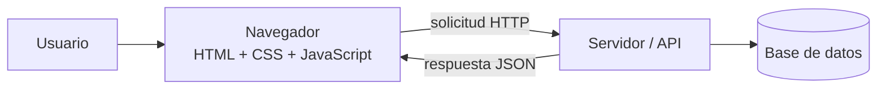

**En este proyecto** solo existe el lado izquierdo del diagrama. El servidor se **simula**: los archivos JSON hacen el papel de las respuestas, y una variable en memoria hace el papel de la base de datos. La sección 6 explica qué faltaría para tener un backend real.

### 1.2 HTML, CSS y JavaScript: tres responsabilidades

**Idea central.** Cada tecnología responde una pregunta distinta:

| Tecnología | Pregunta que responde | Analogía |
|---|---|---|
| HTML | ¿Qué contenido hay y qué significa? | La estructura de una casa: paredes, puertas, habitaciones. |
| CSS | ¿Cómo se ve? | La pintura, los muebles, la iluminación. |
| JavaScript | ¿Qué hace cuando el usuario interactúa? | La instalación eléctrica: lo que responde al pulsar un interruptor. |

**Por qué se separan.** Si todo estuviera mezclado, cambiar el color de un botón obligaría a tocar el mismo archivo que define cómo se guarda un estudiante. Separar responsabilidades permite modificar una parte sin arriesgar las demás.

**En este proyecto** las dos versiones usan **la misma hoja de estilos** (`legacy/css/styles.css` y su copia idéntica `react/src/styles/styles.css`). Eso demuestra que React no cambia cómo se escribe CSS: cambia cómo se produce y se actualiza el HTML.

### 1.3 Qué hace el navegador al abrir una página

Entender este proceso es la base para comprender ambos enfoques:

1. Descarga el HTML y lo **analiza**, construyendo en memoria un árbol de objetos: el **DOM**.
2. Descarga el CSS y calcula qué estilo corresponde a cada elemento.
3. **Dibuja** la página en la pantalla a partir del DOM y los estilos.
4. Ejecuta el JavaScript, que puede **leer y modificar el DOM**. Cada modificación hace que el navegador vuelva a calcular y dibujar las partes afectadas.

**DOM (Document Object Model).** Es la representación de la página como un árbol de objetos. Cada etiqueta es un nodo con propiedades (`textContent`, `value`, `className`) y métodos (`appendChild`, `remove`):

```
document
└── html
    └── body
        └── main
            └── table
                └── tbody  ← en legacy, JavaScript agrega aquí una <tr> por estudiante
```

Punto clave para la clase: **lo que el usuario ve es el DOM**. Ambos enfoques terminan modificando el DOM; la diferencia es *quién* escribe esas modificaciones.

### 1.4 Qué es una aplicación web tradicional

**Idea central.** En el enfoque tradicional, el programador escribe el HTML inicial y luego usa JavaScript para modificar el DOM directamente cada vez que algo cambia.

A esto se le llama programación **imperativa**: se dan órdenes paso a paso. Por ejemplo: "crea una fila", "ponle este texto", "agrégala a la tabla", "quita el mensaje de carga".

### 1.5 Qué es una biblioteca de interfaz como React

**Idea central.** React es una **biblioteca** de JavaScript para construir interfaces. Su propuesta se resume en una fórmula:

> **interfaz = f(estado)**

La interfaz es el resultado de aplicar una función a los datos actuales. El programador escribe esa función (un **componente**) y React se ocupa de que el DOM coincida con su resultado. A esto se le llama programación **declarativa**: se describe *qué* se quiere ver, no *cómo* llegar a ello.

**Biblioteca frente a framework.** Una biblioteca resuelve un problema concreto (React: la interfaz) y el programador decide cómo organizar el resto. Un framework impone la estructura completa de la aplicación. Por eso, en este proyecto, el acceso a datos y las validaciones son JavaScript común, sin nada de React.

**Mensaje para la diapositiva:** React **no reemplaza** a HTML, CSS ni JavaScript. El JSX genera HTML, los estilos son CSS y toda la lógica es JavaScript. Quien no domina esas tres tecnologías tendrá dificultades con React.

---

## Sección 2. El enfoque legacy

### 2.1 Organización del código

**Idea central.** Aunque no se use ninguna biblioteca, el código puede (y debe) organizarse por responsabilidades.

```
legacy/
├── index.html                       Estructura completa de la interfaz
├── css/styles.css                   Presentación
├── js/
│   ├── mensajes.js                  Textos que ve el usuario
│   ├── utilidades.js                Funciones puras: código, búsqueda, formato
│   ├── validaciones.js              Reglas: deciden si hay errores
│   ├── servicios/estudiantesService.js   Acceso a datos
│   ├── estudiantes.js               Presentación: leen y modifican el DOM
│   └── app.js                       Coordinación: estado, eventos, flujo
└── datos/
    ├── estudiantes.json, carreras.json   Datos de prueba
    └── datos-locales.js             Copia para abrir la página con doble clic
```

La organización sigue una regla: **cada capa solo conoce a la de abajo**.

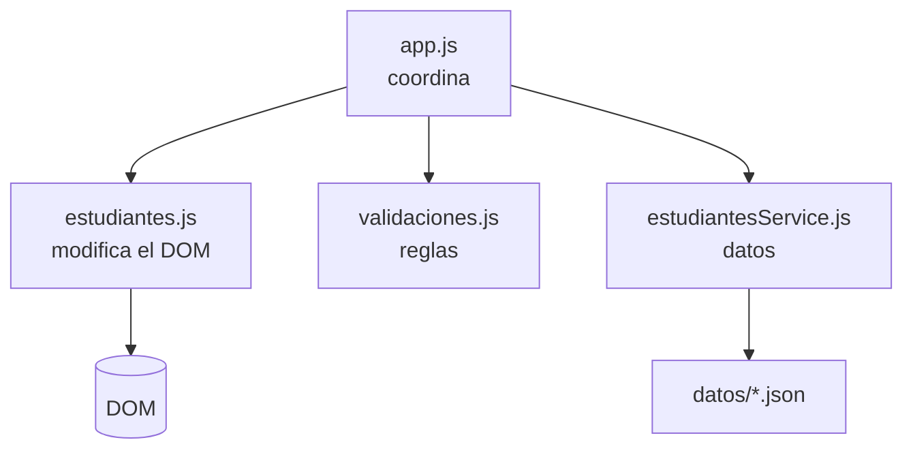

Por ejemplo, `validaciones.js` no sabe que existe una pantalla: recibe datos y devuelve errores. Gracias a eso, la versión React pudo usar **las mismas reglas** sin cambiar una línea.

### 2.2 El ámbito global y el orden de los scripts

**Idea central.** Sin módulos, todos los archivos JavaScript de una página comparten un único espacio de nombres: el **ámbito global**.

**Cómo funciona.** Cuando `mensajes.js` declara `const MENSAJES = {...}`, esa constante queda disponible para cualquier script que se ejecute después. Por eso el orden de carga importa:

**Archivo:** `legacy/index.html`
```html
<script src="js/mensajes.js" defer></script>
<script src="js/utilidades.js" defer></script>
<script src="js/validaciones.js" defer></script>
<!-- Copia de los datos usada solo si la página se abre con doble clic (file://). -->
<script src="datos/datos-locales.js" defer></script>
<script src="js/servicios/estudiantesService.js" defer></script>
<script src="js/estudiantes.js" defer></script>
<script src="js/app.js" defer></script>
```

El atributo `defer` indica al navegador que descargue los scripts en paralelo, pero que los **ejecute en este orden** y solo cuando el HTML ya esté analizado. Así, cuando `estudiantes.js` busca elementos con `getElementById`, esos elementos ya existen.

**Errores frecuentes.**

- Cambiar el orden: si `estudiantes.js` se carga después de `app.js`, la página queda vacía y la consola muestra `ReferenceError: dom is not defined`, porque `app.js` usa el objeto `dom` antes de que exista.
- Confiar en que "funciona": si se mueve `utilidades.js` al final, la página **sigue funcionando**. `generarCodigo` solo se llama después de esperar los datos, y para entonces el script ya se cargó. El error depende del momento en que se ejecuta cada línea, no solo del orden de los archivos. Por eso estos problemas son difíciles de detectar: pueden aparecer más tarde, cuando alguien cambia la demora o reorganiza el código.
- Repetir un nombre: si dos archivos declaran `const estado`, el segundo provoca un error. En proyectos grandes, este riesgo crece con cada archivo.

**Para la clase.** Primero mover `<script src="js/utilidades.js">` al final de la lista y recargar: todo funciona. Luego hacer lo mismo con `estudiantes.js`: la tabla no carga y la consola muestra el error. Preguntar: ¿por qué uno falla y el otro no? ¿Cómo sabría un programador nuevo en qué orden van los archivos?

### 2.3 Construcción manual del formulario

**Idea central.** En el enfoque tradicional, toda la estructura de la interfaz se escribe en HTML desde el principio, incluidos los contenedores vacíos que JavaScript llenará después.

**Archivo:** `legacy/index.html`
```html
<div class="campo">
  <label for="correo">Correo electrónico <span class="obligatorio">*</span></label>
  <input id="correo" name="correo" type="email" maxlength="100" aria-describedby="error-correo" />
  <span id="error-correo" class="campo__error"></span>
</div>
```

Cada atributo cumple una función:

- `for="correo"` asocia la etiqueta con el campo: al hacer clic en el texto se enfoca el campo, y un lector de pantalla anuncia la etiqueta.
- `id="correo"` permite que JavaScript encuentre el campo.
- `name="correo"` permite leerlo como `formulario.elements.correo`.
- El `<span id="error-correo">` vacío es el lugar donde JavaScript escribirá el mensaje de error. `aria-describedby` hace que el lector de pantalla también lea ese mensaje.

El formulario tiene el atributo `novalidate`, que desactiva los mensajes automáticos del navegador. Así, todas las validaciones usan las mismas reglas y los mismos textos, tanto aquí como en React.

### 2.4 Seleccionar elementos del DOM

**Idea central.** Para modificar algo en la pantalla, JavaScript primero necesita una **referencia** al objeto del DOM correspondiente.

**Archivo:** `legacy/js/estudiantes.js`
```js
const dom = {
  mensajeGeneral: document.getElementById("mensaje-general"),
  formulario: document.getElementById("formulario-estudiante"),
  // ...
  cuerpoTabla: document.getElementById("cuerpo-tabla"),
  estadoTabla: document.getElementById("estado-tabla"),
  // ...
};
```

**Por qué se guardan en un objeto.** Buscar un elemento recorre el documento. Hacerlo una sola vez al inicio evita repetir búsquedas y deja en un solo lugar la lista de elementos que el código necesita.

**Lo que este objeto revela.** Es el **contrato** entre el HTML y el JavaScript. Si alguien cambia `id="cuerpo-tabla"` en el HTML, `dom.cuerpoTabla` será `null` y la aplicación fallará al intentar usarlo. El navegador no avisa del problema hasta que se ejecuta esa línea.

### 2.5 Eventos: reaccionar al usuario

**Idea central.** Un **evento** es una notificación del navegador: "el usuario hizo clic", "escribió una letra", "envió el formulario". Con `addEventListener` se indica qué función ejecutar cuando ocurre.

**Archivo:** `legacy/js/app.js`
```js
function registrarEventos() {
  dom.formulario.addEventListener("submit", manejarEnvioFormulario);
  dom.formulario.addEventListener("input", manejarCambioCampo);
  dom.botonCancelar.addEventListener("click", manejarCancelar);
  dom.buscador.addEventListener("input", manejarBusqueda);
  dom.cuerpoTabla.addEventListener("click", manejarClicTabla);
  dom.dialogoCancelar.addEventListener("click", cancelarEliminacion);
  dom.dialogoConfirmar.addEventListener("click", confirmarEliminacion);
  document.addEventListener("keydown", manejarTeclado);
}
```

**Por qué se registran una sola vez.** Cada llamada a `addEventListener` **agrega** un manejador; no reemplaza el anterior. Si esta función se ejecutara cada vez que se redibuja la tabla, después de cinco actualizaciones un solo clic ejecutaría la acción cinco veces.

#### Propagación y delegación de eventos

**Cómo funciona.** Cuando se hace clic en un botón, el evento no se queda en el botón: **sube** por todos sus ancestros (`td`, `tr`, `tbody`, `table`...). A esto se le llama **propagación** (*bubbling*). Por eso un manejador registrado en el `<tbody>` se entera de los clics en cualquier botón de cualquier fila.

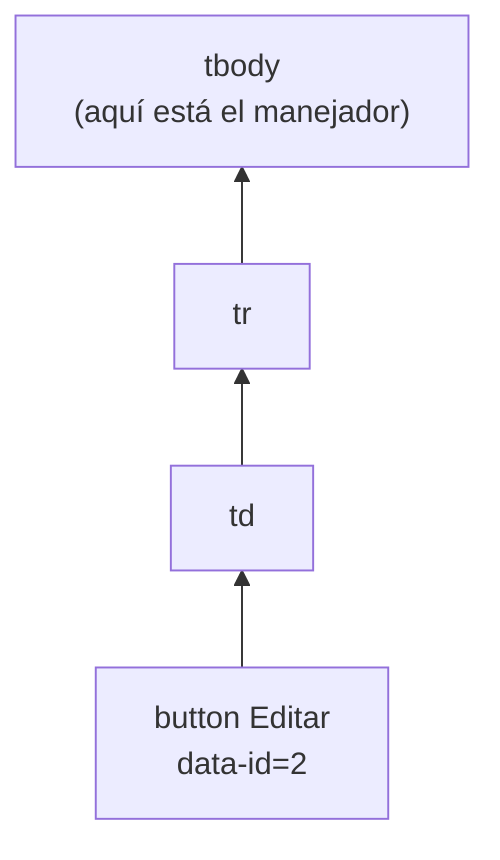

**Por qué se usa aquí.** Las filas de la tabla se destruyen y se vuelven a crear con cada actualización. Si cada botón tuviera su propio manejador, habría que registrarlo de nuevo cada vez. Con la delegación, un solo manejador sirve para todas las filas, presentes y futuras.

**Archivo:** `legacy/js/app.js`
```js
function manejarClicTabla(evento) {
  const boton = evento.target.closest("button[data-accion]");
  if (!boton || estado.guardando) {
    return;
  }

  // Los atributos data-* siempre son texto, por eso se convierte el id a número.
  const id = Number(boton.dataset.id);
  if (boton.dataset.accion === "editar") {
    iniciarEdicion(id);
  } else if (boton.dataset.accion === "eliminar") {
    solicitarEliminacion(id);
  }
}
```

Paso a paso:

1. `evento.target` es el elemento exacto donde se hizo clic.
2. `closest(...)` sube desde ese elemento hasta encontrar un botón con `data-accion`. Si el clic fue en una celda sin botón, devuelve `null` y la función termina.
3. Los atributos `data-accion` y `data-id`, escritos al crear la fila, indican qué hacer y con qué estudiante.

**Error frecuente.** Olvidar `Number(...)`: `boton.dataset.id` es el texto `"2"`, y la comparación `estudiante.id === "2"` es falsa porque el `id` del JSON es el número `2`.

### 2.6 Programación asíncrona: promesas y `async/await`

Este tema es necesario para entender cómo se consultan datos en **ambas** versiones.

**Idea central.** Consultar datos por la red tarda un tiempo desconocido. JavaScript no puede detener el navegador mientras espera, porque la página se congelaría. Por eso estas operaciones son **asíncronas**: se inician, el programa continúa, y el resultado llega más tarde.

**Promesa.** Es un objeto que representa un resultado futuro. Pasa por tres estados:

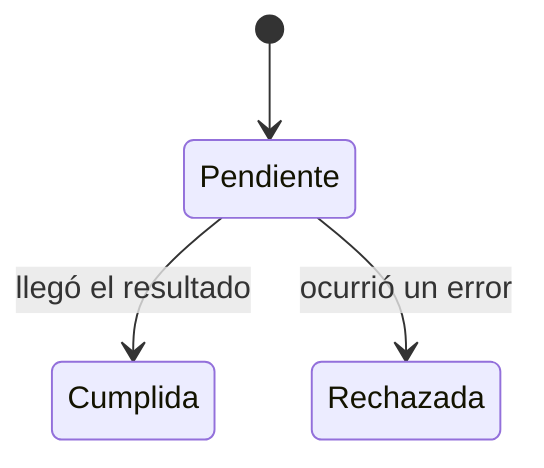

**`async/await`.** Es una forma de escribir código asíncrono que se lee como si fuera secuencial. `await` pausa **solo la función actual** hasta que la promesa se resuelve, mientras el navegador sigue respondiendo. Si la promesa se rechaza, `await` lanza un error que se captura con `try/catch`.

**En el código.** El servicio simula la demora de la red convirtiendo `setTimeout` en una promesa:

**Archivo:** `legacy/js/servicios/estudiantesService.js`
```js
function esperar(ms) {
  return new Promise((resolver) => setTimeout(resolver, ms));
}
```

`setTimeout` ejecuta una función después de cierto tiempo, pero no devuelve una promesa. Al envolverlo en `new Promise`, se puede escribir `await esperar(800)` y el código se lee de arriba abajo.

### 2.7 Consultar los datos con `fetch`

**Idea central.** `fetch` es la función del navegador para hacer solicitudes HTTP. Devuelve una promesa con la respuesta del servidor.

**Archivo:** `legacy/js/servicios/estudiantesService.js`
```js
async function consultarJson(nombreArchivo) {
  await simularRed();
  // ...
  const respuesta = await fetch(`${CONFIG_API.urlBase}/${nombreArchivo}`);
  if (!respuesta.ok) {
    throw new Error(`No se pudo leer ${nombreArchivo} (HTTP ${respuesta.status}).`);
  }
  return respuesta.json();
}
```

Se necesitan **dos** `await` porque hay dos esperas distintas. Primero, `fetch` se resuelve cuando llegan los encabezados de la respuesta. Después, `respuesta.json()` lee el cuerpo y lo convierte de texto JSON a objetos de JavaScript.

**Error frecuente.** Suponer que `fetch` falla cuando el servidor responde con un error. **No es así**: `fetch` solo rechaza la promesa si no hubo comunicación (sin red, servidor apagado). Una respuesta `404 Not Found` o `500` se considera una respuesta válida. Por eso hay que revisar `respuesta.ok` y lanzar el error manualmente.

**Por qué el acceso a datos está en un archivo aparte.** El resto de la aplicación no sabe que existe `fetch` ni de dónde vienen los datos; solo llama a `obtenerEstudiantes()`. Si mañana los datos vienen de un servidor real, solo cambia este archivo (sección 6).

### 2.8 Construir la tabla dinámicamente

**Idea central.** La tabla no está escrita en el HTML con los doce estudiantes. JavaScript la construye a partir de los datos, creando cada elemento con instrucciones explícitas.

**Archivo:** `legacy/js/estudiantes.js`
```js
function crearFilaEstudiante(estudiante, carreras, idEnEdicion) {
  const fila = document.createElement("tr");
  if (estudiante.id === idEnEdicion) {
    fila.classList.add("tabla__fila--edicion");
  }

  fila.appendChild(crearCelda(estudiante.codigo, "Código"));
  fila.appendChild(crearCelda(estudiante.nombres, "Nombres"));
  // ...
  const botonEditar = document.createElement("button");
  botonEditar.type = "button";
  botonEditar.className = "boton boton--pequeno boton--secundario";
  botonEditar.textContent = "Editar";
  botonEditar.dataset.accion = "editar";
  botonEditar.dataset.id = estudiante.id;
  // ...
  return fila;
}
```

Para un solo botón se necesitan seis instrucciones: crearlo, asignar su tipo, su clase, su texto y sus dos atributos de datos. Ese es el costo visible del enfoque imperativo: cada detalle de la pantalla es una línea de código.

#### `textContent` frente a `innerHTML`

`textContent` inserta el texto tal cual. `innerHTML` lo interpreta como HTML. Si un estudiante se registrara con el nombre ``, con `innerHTML` el navegador crearía esa imagen y ejecutaría el código. Este tipo de ataque se llama **XSS** (*cross-site scripting*). Con `textContent` el nombre se muestra literalmente y no ocurre nada.

**Para la clase.** Registrar un estudiante con el nombre `<b>Ana</b>` en ambas versiones. En las dos se ve el texto con los símbolos `<b>`: legacy lo protege con `textContent` y React escapa el texto automáticamente.

### 2.9 Actualizar la interfaz

**Idea central.** Cuando los datos cambian, el navegador no lo sabe. El programador debe decidir qué partes de la pantalla dependen de esos datos y actualizarlas.

**Archivo:** `legacy/js/estudiantes.js`
```js
function renderizarTabla(estudiantesVisibles, totalEstudiantes, carreras, idEnEdicion) {
  dom.contador.textContent = `Mostrando ${estudiantesVisibles.length} de ${totalEstudiantes} estudiantes`;

  if (totalEstudiantes === 0) {
    mostrarEstadoTabla(MENSAJES.listaVacia, "info");
    return;
  }
  if (estudiantesVisibles.length === 0) {
    mostrarEstadoTabla(MENSAJES.sinResultados, "info");
    return;
  }

  dom.estadoTabla.replaceChildren();
  // ...
  const fragmento = document.createDocumentFragment();
  estudiantesVisibles.forEach((estudiante) => {
    fragmento.appendChild(crearFilaEstudiante(estudiante, carreras, idEnEdicion));
  });
  dom.cuerpoTabla.replaceChildren(fragmento);
}
```

**La estrategia: borrar y reconstruir.** El código no intenta averiguar qué fila cambió. Borra todas y las vuelve a crear. Es la forma más simple de garantizar que la tabla coincida con los datos, porque no hay que llevar la cuenta de qué elemento corresponde a qué estudiante.

**El costo de esa estrategia.** Con 12 filas es imperceptible. Con miles, el navegador hace mucho trabajo innecesario. Además se pierde el estado propio de los elementos reemplazados: si una fila tuviera un campo con texto escrito o el foco del teclado, desaparecerían.

**`DocumentFragment`.** Es un contenedor que no forma parte de la página. Las filas se arman ahí y se insertan todas juntas, de modo que el navegador recalcula y dibuja la tabla **una vez** en lugar de una vez por fila.

**Para la clase (demostración D2).** Abrir F12 > Elementos, expandir `<tbody id="cuerpo-tabla">` y escribir en el buscador. El inspector resalta todas las filas porque cada pulsación las reemplaza.

### 2.10 El estado gestionado manualmente

**Idea central.** El **estado** es el conjunto de datos que determinan lo que se ve en un momento dado: qué estudiantes hay, qué se está buscando, si se está editando a alguien, si hay una carga en curso.

**Archivo:** `legacy/js/app.js`
```js
const estado = {
  estudiantes: [], // Copia local de la colección devuelta por el servicio.
  carreras: [],
  textoBusqueda: "",
  idEnEdicion: null, // null significa que el formulario está en modo registro.
  idPorEliminar: null, // Estudiante pendiente de confirmación de eliminación.
  cargando: false,
  guardando: false,
};
```

**El punto más importante de esta sección:** `estado` es un objeto común. **Modificarlo no cambia nada en la pantalla.** El código debe recordar, en cada caso, qué funciones llamar.

Ejemplo **ilustrativo** de un error típico de este enfoque:

```js
// Ilustrativo: versión con un olvido
function iniciarEdicion(id) {
  const estudiante = estado.estudiantes.find((item) => item.id === id);
  estado.idEnEdicion = id;
  cargarFormulario(estudiante);
  // Falta establecerModoFormulario(true);
}
```

Esta versión no produce ningún error en la consola. Sin embargo, el formulario muestra los datos del estudiante con el título "Registrar estudiante" y el botón "Registrar estudiante". El usuario cree que va a crear un registro nuevo, pero en realidad modificará uno existente. Este tipo de inconsistencia es el principal problema de mantenimiento del enfoque imperativo.

**El estado también vive en el DOM.** El objeto `estado` no lo contiene todo. Los valores que el usuario escribe en el formulario solo están en los campos del DOM, por eso existe `leerFormulario()`. Si el cuadro de confirmación está visible o no, depende del atributo `hidden`. Para conocer el estado completo de la aplicación hay que mirar en varios lugares.

---

## Sección 3. El enfoque React

### 3.1 Organización del proyecto

```
react/
├── index.html                     Solo contiene <div id="root"></div>
├── public/datos/*.json            Datos de prueba (los mismos de legacy)
└── src/
    ├── main.jsx                   Conecta React con la página
    ├── App.jsx                    Componente raíz: estado compartido
    ├── components/                Una pieza de interfaz por archivo
    ├── hooks/useEstudiantes.js    Datos y carga inicial
    ├── services/estudiantesService.js
    ├── utils/                     mensajes.js, utilidades.js, validaciones.js
    └── styles/styles.css
```

**En este proyecto**, `utils/` contiene exactamente las mismas reglas que la versión legacy. El servicio es el mismo, salvo dos diferencias: usa `export` y no necesita la copia para abrir la página con doble clic. Como ambas versiones comparten las reglas y el acceso a datos, **la comparación se concentra en la capa de interfaz**, que es donde los enfoques difieren.

**Módulos ES.** A diferencia de legacy, cada archivo es un **módulo**: lo que declara es privado, salvo lo que exporta con `export`. Quien lo necesita lo importa con `import`. Así desaparecen los dos problemas de la sección 2.2: el orden de carga lo resuelve la herramienta (Vite) siguiendo los `import`, y los nombres no chocan entre archivos.

**Vite.** El navegador no entiende JSX. Vite es la herramienta que, durante el desarrollo, transforma los archivos `.jsx` en JavaScript, sirve la aplicación en `localhost:5173` y la recarga al guardar un cambio.

### 3.2 El punto de entrada: React toma el control de un contenedor

**Archivo:** `react/index.html`
```html
<div id="root"></div>
<script type="module" src="/src/main.jsx"></script>
```

**Archivo:** `react/src/main.jsx`
```jsx
createRoot(document.getElementById("root")).render(
```

Esta es la **única** búsqueda en el DOM de toda la aplicación. A partir de aquí, React administra todo el contenido de `#root`. El HTML inicial está vacío porque la interfaz se genera a partir de los componentes.

Comparar con legacy: allí la interfaz completa está escrita en `index.html` y JavaScript la modifica. Aquí no hay interfaz escrita en el HTML: se **calcula**.

### 3.3 Componentes

**Idea central.** Un **componente** es una función de JavaScript que recibe datos y devuelve la descripción de una parte de la interfaz. Su nombre empieza con mayúscula y se usa como si fuera una etiqueta: `<EstudianteRow />`.

**Cómo dividir una interfaz en componentes.** La pregunta guía es: *¿qué parte de la pantalla tiene una responsabilidad propia?*

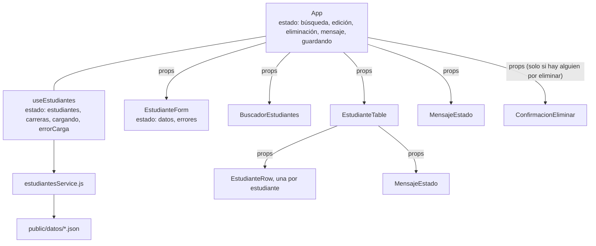

| Componente | ¿Tiene estado? | Responsabilidad |
|---|---|---|
| `App` | Sí | Mantiene el estado compartido y decide qué ocurre ante cada acción. |
| `EstudianteForm` | Sí (valores y errores) | Captura y valida los datos; los entrega al padre. |
| `EstudianteTable` | No | Decide si mostrar filas o un mensaje de estado. |
| `EstudianteRow` | No | Muestra un estudiante y sus botones. |
| `BuscadorEstudiantes` | No | Muestra el campo de búsqueda. |
| `MensajeEstado` | No | Muestra un mensaje de carga, información, éxito o error. |
| `ConfirmacionEliminar` | No | Pide confirmación antes de eliminar. |

**Componentes con estado y componentes de presentación.** Casi todos los componentes de la tabla anterior no tienen estado: muestran lo que reciben. Son fáciles de entender porque, para los mismos datos, siempre muestran lo mismo. El estado se concentra en pocos lugares (`App`, el hook y el formulario), y ahí está la lógica.

**Error frecuente.** Dividir demasiado, por ejemplo creando un componente para cada celda. Un componente debe aportar una responsabilidad reconocible; si no, solo agrega archivos y props que pasar.

### 3.4 JSX

**Idea central.** JSX es una sintaxis que permite escribir, dentro de JavaScript, una descripción de la interfaz con aspecto de HTML.

**Archivo:** `react/src/components/EstudianteRow.jsx`
```jsx
<tr className={enEdicion ? "tabla__fila--edicion" : undefined}>
  <td data-etiqueta="Código">{estudiante.codigo}</td>
  <td data-etiqueta="Nombres">{estudiante.nombres}</td>
```

**Cómo funciona.** JSX no llega al navegador. Vite lo convierte en llamadas a funciones de JavaScript que crean objetos que describen elementos. De forma **ilustrativa**, la segunda línea se transforma en algo similar a:

```js
// Ilustrativo: resultado aproximado de la transformación
jsx("td", { "data-etiqueta": "Código", children: estudiante.codigo });
```

Por eso JSX tiene reglas propias:

- Las llaves `{}` contienen **expresiones** de JavaScript: variables, operaciones, llamadas a funciones, operadores ternarios. No admiten instrucciones como `if` o `for`.
- `className` en lugar de `class`, y `htmlFor` en lugar de `for`, porque `class` y `for` son palabras reservadas de JavaScript.
- Los atributos se escriben en *camelCase*: `noValidate`, `maxLength`, `onClick`.
- Un componente devuelve un solo elemento raíz. Si se necesitan varios, se agrupan en un **fragmento** `<>...</>`, que no genera ninguna etiqueta en el DOM.

**Comparar con 2.8.** En legacy, la fila se construye con `createElement`, `classList.add`, `textContent` y `appendChild`. Aquí se describe el resultado y React se encarga de crear los elementos. Además, React escapa automáticamente el texto, igual que `textContent`.

### 3.5 Props: cómo se comunican los componentes

**Idea central.** Las **props** son los parámetros de un componente. El padre las entrega y el hijo las lee, pero **nunca las modifica**.

**Archivo:** `react/src/App.jsx`
```jsx
<BuscadorEstudiantes valor={textoBusqueda} onCambiar={setTextoBusqueda} />
```

**Archivo:** `react/src/components/BuscadorEstudiantes.jsx`
```jsx
export default function BuscadorEstudiantes({ valor, onCambiar }) {
  // ...
      <input
        id="buscador"
        // ...
        value={valor}
        // onChange en React se dispara con cada tecla (como el evento "input" del DOM).
        onChange={(evento) => onCambiar(evento.target.value)}
      />
```

**Flujo de datos en un solo sentido.** Los datos **bajan** del padre al hijo (`valor`). Cuando ocurre algo, el hijo **avisa hacia arriba** llamando a una función que también recibió como prop (`onCambiar`). Es el padre quien cambia el estado.

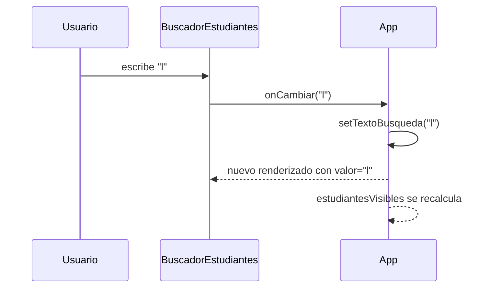

**Por qué en un solo sentido.** Si cualquier componente pudiera modificar cualquier dato, sería difícil saber quién cambió algo. Con este flujo, para entender de dónde viene un valor basta con subir por el árbol de componentes hasta encontrar quién lo guarda.

**Componente controlado.** El campo de búsqueda no guarda su propio valor: lo recibe de `App`. Si `App` no actualizara `textoBusqueda`, el campo no mostraría lo que el usuario escribe. Así, el estado de React es la **única fuente de verdad**.

### 3.6 Estado con `useState`

**Idea central.** `useState` permite que un componente **recuerde** un valor entre ejecuciones y que, al cambiarlo, la pantalla se actualice.

**Por qué no basta una variable común.** Un componente es una función que React ejecuta cada vez que necesita dibujarlo. Una variable declarada dentro se reinicia en cada ejecución, y cambiarla no le avisa a React. `useState` resuelve ambos problemas: React guarda el valor por fuera de la función y la vuelve a ejecutar cuando se llama a la función `set...`.

**Archivo:** `react/src/App.jsx`
```jsx
const [textoBusqueda, setTextoBusqueda] = useState("");
const [idEnEdicion, setIdEnEdicion] = useState(null);
const [estudiantePorEliminar, setEstudiantePorEliminar] = useState(null);
const [guardando, setGuardando] = useState(false);
const [mensaje, setMensaje] = useState(null); // { tipo, texto } o null
```

Son los mismos conceptos del objeto `estado` de legacy (sección 2.10). La diferencia fundamental es que **cambiar estos valores sí actualiza la pantalla**.

#### El ciclo de renderizado

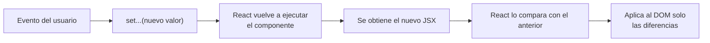

Este proceso de comparación se llama **reconciliación**. Gracias a él, React no borra y reconstruye la tabla como lo hace legacy: si solo cambió el nombre de un estudiante, solo actualiza el texto de esa celda.

#### Inmutabilidad: por qué no se usa `push`

**Archivo:** `react/src/components/EstudianteForm.jsx`
```jsx
function manejarCambio(evento) {
  const { name, value } = evento.target;
  setDatos((anteriores) => ({ ...anteriores, [name]: value }));
```

En lugar de modificar el objeto existente (`datos.nombres = value`), se crea un objeto nuevo que copia el anterior y reemplaza una propiedad. La razón: para decidir si algo cambió, React compara el valor anterior con el nuevo **por referencia**, es decir, si son el mismo objeto en memoria. Si se modifica el mismo objeto, la referencia no cambia, React concluye que no hubo cambios y la pantalla no se actualiza.

**Error frecuente**, **ilustrativo**:

```js
// Ilustrativo: no actualiza la pantalla
estudiantes.push(nuevo);
setEstudiantes(estudiantes); // mismo arreglo: React no detecta el cambio
```

#### Valores derivados

No todo lo que se muestra necesita su propio estado. Lo que se puede **calcular** a partir del estado se calcula en cada renderizado:

**Archivo:** `react/src/App.jsx`
```jsx
const estudiantesVisibles = filtrarEstudiantes(estudiantes, textoBusqueda);
const estudianteEnEdicion = estudiantes.find((estudiante) => estudiante.id === idEnEdicion) ?? null;
const datosDisponibles = !cargando && !errorCarga;
```

Si la lista filtrada se guardara en otro `useState`, habría que acordarse de actualizarla cada vez que cambiara la colección o la búsqueda, que es exactamente el problema de legacy. Al calcularla, nunca queda desactualizada.

### 3.7 Efectos con `useEffect`: la carga inicial

**Idea central.** Un componente debe limitarse a calcular qué mostrar. Las acciones que salen de React (consultar la red, programar un temporizador, escuchar el teclado) se llaman **efectos** y se declaran con `useEffect`. React los ejecuta **después** de mostrar el componente en pantalla.

**Por qué la consulta no puede ir en el cuerpo del componente.** El cuerpo se ejecuta en cada renderizado. Si la consulta estuviera ahí:

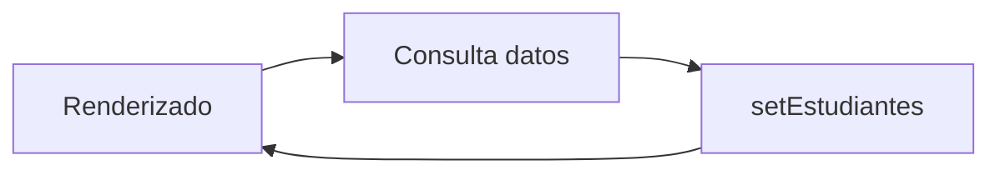

Se produciría un ciclo infinito de consultas.

**Archivo:** `react/src/hooks/useEstudiantes.js`
```js
useEffect(() => {
  // ...
  let cancelado = false;

  async function cargarDatos() {
    try {
      // ...
      const [carrerasRecibidas, estudiantesRecibidos] = await Promise.all([
        obtenerCarreras(),
        obtenerEstudiantes(),
      ]);
      if (!cancelado) {
        setCarreras(carrerasRecibidas);
        setEstudiantes(estudiantesRecibidos);
        setErrorCarga(null);
      }
    } catch (error) {
      // ...
      if (!cancelado) {
        setErrorCarga(error);
      }
    } finally {
      if (!cancelado) {
        setCargando(false);
      }
    }
  }
  // ...
  cargarDatos();

  return () => {
    cancelado = true;
  };
}, [intentoCarga]);
```

Tres conceptos que conviene explicar por separado:

1. **El arreglo de dependencias** (`[intentoCarga]`) le dice a React cuándo repetir el efecto: al montar el componente y cada vez que cambie alguno de esos valores. Con `[]` se ejecutaría una sola vez. En este proyecto, el botón **Reintentar** incrementa `intentoCarga`, y eso provoca una nueva consulta.
2. **La función de limpieza** (el `return`) se ejecuta antes de repetir el efecto o cuando el componente desaparece. Aquí marca `cancelado = true` para ignorar una respuesta que llegue tarde y ya no sea útil.
3. **`async` dentro del efecto.** La función que recibe `useEffect` no puede ser `async`, porque debe devolver la limpieza y no una promesa. Por eso se declara una función `async` interna (`cargarDatos`) y se invoca.

**`StrictMode` y las solicitudes duplicadas.** En desarrollo, React monta, desmonta y vuelve a montar cada componente a propósito, para detectar efectos sin limpieza. Por eso, en la pestaña Red, las consultas iniciales aparecen dos veces. Gracias a `cancelado`, solo se usa la segunda respuesta. En la versión compilada para producción esto no ocurre.

**Otro efecto, para comparar con legacy.** Los mensajes de éxito desaparecen después de cuatro segundos:

**Archivo:** `react/src/App.jsx`
```jsx
useEffect(() => {
  if (mensaje?.tipo !== "exito") {
    return undefined;
  }
  const temporizador = setTimeout(() => setMensaje(null), DURACION_MENSAJE_EXITO_MS);
  return () => clearTimeout(temporizador);
}, [mensaje]);
```

**Archivo:** `legacy/js/estudiantes.js`
```js
function mostrarMensaje(texto, tipo) {
  clearTimeout(temporizadorMensaje);
  // ...
  if (tipo === "exito") {
    temporizadorMensaje = setTimeout(ocultarMensaje, DURACION_MENSAJE_EXITO_MS);
  }
}
```

Ambas versiones resuelven el mismo problema: si llega un mensaje nuevo, hay que cancelar el temporizador del anterior para que no lo borre antes de tiempo. En legacy, el temporizador se guarda en una variable global y se cancela manualmente. En React, la cancelación está en la función de limpieza, que React ejecuta automáticamente cuando `mensaje` cambia.

### 3.8 Hooks personalizados

**Idea central.** Un hook personalizado es una función cuyo nombre empieza con `use` y que utiliza otros hooks. Sirve para **extraer** lógica con estado de un componente y darle un nombre.

**En este proyecto**, `useEstudiantes` agrupa todo lo relacionado con los datos: las colecciones, el estado de carga, el efecto de consulta y las operaciones de registrar, modificar y eliminar. `App` solo escribe:

**Archivo:** `react/src/App.jsx`
```jsx
const {
  estudiantes,
  carreras,
  cargando,
  errorCarga,
  reintentarCarga,
  registrarEstudiante,
  modificarEstudiante,
  borrarEstudiante,
} = useEstudiantes();
```

Así, `App` puede concentrarse en la interfaz. Si otra pantalla necesitara la lista de estudiantes, reutilizaría el mismo hook.

### 3.9 Renderizado condicional

**Idea central.** En JSX, lo que no se debe mostrar simplemente **no se devuelve**. Se decide con JavaScript común: `if`, el operador ternario (`condición ? a : b`) o el operador `&&`.

**Archivo:** `react/src/components/EstudianteTable.jsx`
```jsx
let estadoTabla = null;
if (cargando) {
  estadoTabla = <MensajeEstado tipo="cargando" texto={MENSAJES.cargando} />;
} else if (errorCarga) {
  // ...
} else if (totalEstudiantes === 0) {
  estadoTabla = <MensajeEstado tipo="info" texto={MENSAJES.listaVacia} />;
} else if (estudiantes.length === 0) {
  estadoTabla = <MensajeEstado tipo="info" texto={MENSAJES.sinResultados} />;
}
```

**Archivo:** `react/src/App.jsx`
```jsx
{estudiantePorEliminar && (
  <ConfirmacionEliminar
```

`condición && <Elemento />` funciona porque, si la condición es falsa, la expresión vale `false` y React no dibuja nada.

**Comparar con legacy.** El cuadro de confirmación de legacy **existe siempre** en el HTML y se oculta con el atributo `hidden`; el código debe acordarse de mostrarlo y ocultarlo. En React, el cuadro **existe solo mientras** `estudiantePorEliminar` tiene valor. No hay instrucción de "ocultar": basta con poner el estado en `null`.

**Error frecuente.** Usar `&&` con un número: `{lista.length && <Tabla />}` muestra un `0` en la pantalla cuando la lista está vacía, porque `0` es un valor que React sí dibuja. Hay que escribir `lista.length > 0 && ...`.

### 3.10 Renderizado de listas y la prop `key`

**Idea central.** Para mostrar una colección se transforma cada dato en un elemento JSX con `map()`.

**Archivo:** `react/src/components/EstudianteTable.jsx`
```jsx
{mostrarFilas &&
  estudiantes.map((estudiante) => (
    <EstudianteRow
      key={estudiante.id}
      estudiante={estudiante}
      nombreCarrera={obtenerNombreCarrera(carreras, estudiante.carreraId)}
      enEdicion={estudiante.id === idEnEdicion}
      deshabilitado={deshabilitado}
      onEditar={onEditar}
      onEliminar={onEliminar}
    />
  ))}
```

**Para qué sirve `key`.** Al comparar la lista anterior con la nueva (sección 3.6), React necesita saber qué elemento de la nueva lista corresponde a cuál de la anterior. `key` es ese identificador. Con él, React sabe que la fila con `key=3` desapareció y las demás solo se movieron, así que elimina un elemento del DOM en lugar de reescribirlos todos.

**Por qué el `id` y no la posición.** Si se usara la posición en el arreglo como `key` y se eliminara el primer estudiante, el que antes estaba en la posición 1 pasaría a la 0. React creería que la fila 0 sigue siendo la misma, solo que con otros datos. En filas que solo muestran texto, el resultado se ve correcto. Pero si las filas tuvieran estado propio (un campo con texto escrito, una casilla marcada), ese estado quedaría asociado al estudiante equivocado.

**Comparar con legacy.** En legacy no existe este problema porque la tabla se reconstruye entera. `key` es el precio de que React actualice solo lo necesario: hay que darle la información para identificar cada elemento.

### 3.11 Eventos en React

**Idea central.** Los eventos se asignan como props en el JSX (`onClick`, `onChange`, `onSubmit`) y reciben una **función**.

**Archivo:** `react/src/components/EstudianteRow.jsx`
```jsx
<button
  type="button"
  className="boton boton--pequeno boton--secundario"
  aria-label={`Editar a ${nombreCompleto}`}
  disabled={deshabilitado}
  onClick={() => onEditar(estudiante)}
>
  Editar
</button>
```

**Diferencias con legacy.**

- No hay `addEventListener` ni delegación: cada botón recibe su manejador, y la función flecha ya conoce el `estudiante` de su fila. No se necesitan atributos `data-id` ni conversiones de texto a número.
- React se ocupa de registrar y retirar los manejadores cuando los elementos aparecen o desaparecen. No existe el riesgo de registrar manejadores duplicados (sección 2.5).

**Error frecuente.** Escribir `onClick={onEditar(estudiante)}`. Así, la función se **ejecuta durante el renderizado** y su resultado se asigna a `onClick`. Lo correcto es entregar una función que se ejecutará después, al hacer clic: `onClick={() => onEditar(estudiante)}`.

### 3.12 Reiniciar un componente con `key`

**Idea central.** `key` también sirve fuera de las listas. Si la `key` de un componente cambia, React lo trata como un componente **distinto**: destruye el anterior, con su estado, y crea uno nuevo desde cero.

**Archivo:** `react/src/App.jsx`
```jsx
const claveFormulario = !datosDisponibles
  ? "sin-datos"
  : `${estudianteEnEdicion ? `editar-${estudianteEnEdicion.id}` : "nuevo"}-${versionFormulario}`;
```

**Archivo:** `react/src/components/EstudianteForm.jsx`
```jsx
const [datos, setDatos] = useState(() => crearDatosIniciales(estudianteEnEdicion, estudiantes, datosDisponibles));
const [errores, setErrores] = useState({});
```

Cuando se termina de guardar, se inicia una edición o se cancela, la clave cambia. El formulario nuevo calcula sus datos iniciales con `crearDatosIniciales`: vacíos con el siguiente código sugerido, o con los datos del estudiante elegido.

**Comparar con legacy.** `limpiarFormulario()` restablece cada campo uno por uno y borra cada mensaje de error. Si se agrega un campo nuevo y alguien olvida actualizar esa función, el formulario conservará un valor viejo. Con la `key`, el estado inicial se define en un solo lugar.

---

## Sección 4. La misma tarea en ambos enfoques

Esta sección recorre nueve tareas. Para cada una se describe **qué ocurre paso a paso** en cada versión y qué enseña la comparación.

### Tarea 1. Cargar estudiantes

**Qué ocurre en legacy.** Al final de `app.js` se invoca `cargarDatosIniciales()`. Esa función marca el estado, muestra el indicador de carga, espera los datos y luego actualiza una por una las partes de la pantalla que dependen de ellos.

**Archivo:** `legacy/js/app.js`
```js
async function cargarDatosIniciales() {
  estado.cargando = true;
  establecerFormularioHabilitado(false);
  limpiarContador();
  mostrarEstadoTabla(MENSAJES.cargando, "cargando");

  try {
    // Promise.all lanza ambas consultas a la vez y espera a que las dos terminen.
    const [carreras, estudiantes] = await Promise.all([
      obtenerCarreras(),
      obtenerEstudiantes(),
    ]);

    estado.carreras = carreras;
    estado.estudiantes = estudiantes;
    // ...
    if (dom.selectCarrera.options.length === 1) {
      llenarSelectCarreras(carreras);
    }
    limpiarFormulario(generarCodigo(estado.estudiantes));
    establecerFormularioHabilitado(true);
    actualizarTabla();
```

**Qué ocurre en React.** El efecto de `useEstudiantes` (sección 3.7) consulta los datos y llama a `setCarreras`, `setEstudiantes` y `setCargando`. React vuelve a dibujar: la tabla recibe las filas, el `<select>` recibe las carreras, el formulario se habilita y el contador aparece. Ninguna de esas actualizaciones se programa una por una.

**Qué enseña.** Las dos versiones piden los datos de la misma forma (`Promise.all`, mismas funciones del servicio). La diferencia está en lo que ocurre **después**. En legacy, quien escribe la carga debe conocer todas las partes de la pantalla que dependen de los datos. En React, cada componente declara qué datos usa y se actualiza solo.

`Promise.all` inicia las dos consultas a la vez y espera a que **ambas** terminen. Si cualquiera falla, todo el bloque pasa al `catch`. Es útil porque la tabla necesita las carreras para mostrar el nombre de cada una.

### Tarea 2. Mostrar el listado

**Legacy** (secciones 2.8 y 2.9): un bucle crea cada fila con `createElement`, la llena con `textContent` y la agrega con `appendChild`. Cada actualización reconstruye la tabla entera.

**React** (secciones 3.4 y 3.10): `map()` describe una `<EstudianteRow>` por estudiante. React compara con la lista anterior usando `key` y modifica solo lo que cambió.

**Qué enseña.** En legacy, el código responde a *cómo construyo la tabla*. En React responde a *qué debe contener la tabla*. Ambos producen el mismo HTML final: se puede comprobar inspeccionando una fila en cada versión.

### Tarea 3. Buscar un estudiante

Los dos proyectos usan la misma regla de búsqueda:

**Archivo:** `legacy/js/utilidades.js`
```js
function filtrarEstudiantes(estudiantes, textoBusqueda) {
  const criterio = normalizarTexto(textoBusqueda);
  if (criterio === "") {
    return estudiantes;
  }

  return estudiantes.filter((estudiante) =>
    [
      estudiante.codigo,
      estudiante.nombres,
      estudiante.apellidos,
      estudiante.correo,
    ].some((valor) => normalizarTexto(valor).includes(criterio))
  );
}
```

`normalizarTexto` convierte a minúsculas y elimina las tildes. Por eso "lucia" encuentra a "Lucía" y "MENDEZ" encuentra a "Méndez". `filter` no modifica la colección original: devuelve un arreglo nuevo con los elementos que cumplen la condición.

**Qué ocurre en legacy:**

**Archivo:** `legacy/js/app.js`
```js
function actualizarTabla() {
  const visibles = filtrarEstudiantes(estado.estudiantes, estado.textoBusqueda);
  renderizarTabla(visibles, estado.estudiantes.length, estado.carreras, estado.idEnEdicion);
}
// ...
function manejarBusqueda(evento) {
  estado.textoBusqueda = evento.target.value;
  actualizarTabla();
}
```

**Qué ocurre en React:** `BuscadorEstudiantes` llama a `onCambiar`, `App` ejecuta `setTextoBusqueda` y, al volver a dibujarse, recalcula `estudiantesVisibles` (sección 3.6).

**Qué enseña.** En legacy, `actualizarTabla()` debe llamarse en **seis lugares** de `app.js`: al buscar, al cargar, al guardar, al iniciar una edición, al cancelarla y al eliminar. Cada uno es un lugar donde podría olvidarse. En React no existe una función equivalente: la lista filtrada siempre se deriva del estado.

### Tarea 4. Validar el formulario

La regla es una función pura, compartida por ambas versiones, que no sabe nada de la pantalla:

**Archivo:** `react/src/utils/validaciones.js`
```js
export function validarEstudiante(datos, estudiantes, carreras, idEnEdicion) {
  const errores = {};

  if (datos.codigo === "") {
    errores.codigo = MENSAJES_VALIDACION.codigoObligatorio;
  } else {
    const codigoRepetido = estudiantes.some(
      (estudiante) =>
        estudiante.id !== idEnEdicion &&
        estudiante.codigo.toUpperCase() === datos.codigo.toUpperCase()
    );
```

Observe el parámetro `idEnEdicion`. Al editar a un estudiante, su propio código ya existe en la colección; sin esta exclusión, el sistema le impediría guardar sin cambiar su código. El resultado es un objeto `{ campo: "mensaje" }`, vacío si no hay errores.

**Mostrar los errores en legacy:** se escribe en el DOM, campo por campo.

**Archivo:** `legacy/js/estudiantes.js`
```js
function mostrarErrorCampo(campo, mensaje) {
  const control = dom.formulario.elements[campo];
  const contenedorError = document.getElementById(`error-${campo}`);
  contenedorError.textContent = mensaje;
  // aria-invalid informa a las tecnologías de asistencia; la clase cambia el estilo visual.
  control.setAttribute("aria-invalid", mensaje ? "true" : "false");
  control.classList.toggle("campo__control--error", Boolean(mensaje));
}
```

**Mostrar los errores en React:** se guardan en el estado (`setErrores`) y los atributos de cada campo se calculan a partir de ellos.

**Archivo:** `react/src/components/EstudianteForm.jsx`
```jsx
function propsCampo(nombre) {
  return {
    id: nombre,
    name: nombre,
    value: datos[nombre],
    onChange: manejarCambio,
    "aria-invalid": errores[nombre] ? "true" : "false",
    "aria-describedby": `error-${nombre}`,
    className: errores[nombre] ? "campo__control--error" : undefined,
  };
}
```

**Qué enseña.** Separar *decidir* si hay un error de *mostrar* el error permitió reutilizar la regla completa en ambos enfoques. Esta separación no la impone React: es una decisión de diseño válida en cualquier tecnología. Además, es la misma regla que debería aplicar un backend real (sección 6), porque el servidor nunca debe confiar en que el navegador haya validado.

### Tarea 5. Registrar un estudiante

El flujo es el mismo en ambas versiones: leer, limpiar, validar, enviar al servicio, incorporar la respuesta y actualizar la pantalla.

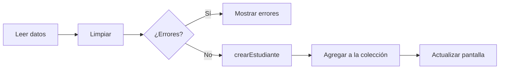

**Archivo:** `legacy/js/app.js`
```js
  // 1. Leer los valores del DOM y normalizarlos.
  const datos = limpiarDatosEstudiante(leerFormulario());

  // 2. Validar con las reglas compartidas.
  const errores = validarEstudiante(datos, estado.estudiantes, estado.carreras, estado.idEnEdicion);
  mostrarErroresValidacion(errores);
  if (tieneErrores(errores)) {
    mostrarMensaje(MENSAJES.erroresValidacion, "error");
    return;
  }
  // ...
      const nuevo = await crearEstudiante(datos);
      estado.estudiantes = [...estado.estudiantes, nuevo];
    }

    // 4. Actualizar manualmente cada parte de la interfaz afectada por el cambio.
    estado.idEnEdicion = null;
    estado.guardando = false;
    mostrarGuardando(false, false);
    limpiarFormulario(generarCodigo(estado.estudiantes));
    actualizarTabla();
```

**Archivo:** `react/src/App.jsx`
```jsx
async function manejarGuardar(datos) {
  setGuardando(true);
  try {
    if (estudianteEnEdicion) {
      await modificarEstudiante(estudianteEnEdicion.id, datos);
      setMensaje({ tipo: "exito", texto: MENSAJES.actualizacionExitosa });
    } else {
      await registrarEstudiante(datos);
      setMensaje({ tipo: "exito", texto: MENSAJES.registroExitoso });
    }
    // Volver al modo registro y pedir un formulario nuevo; React se encarga del resto.
    setIdEnEdicion(null);
    setVersionFormulario((version) => version + 1);
```

**Qué ocurre en React, paso a paso:**

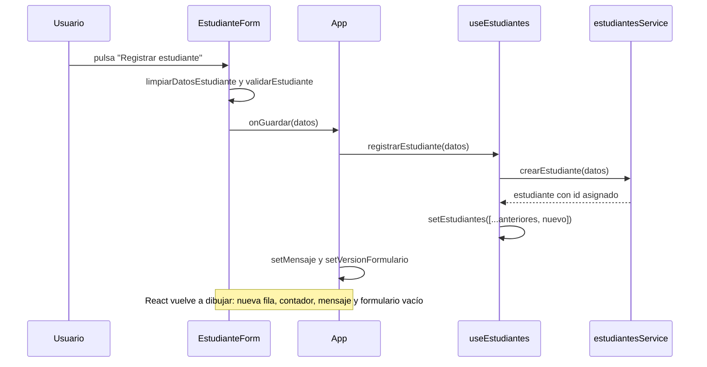

**Qué enseña.** Las dos versiones actualizan la colección de la misma forma inmutable (`[...anteriores, nuevo]`). En legacy es una elección de estilo; en React es obligatorio (sección 3.6). Después de guardar, legacy invoca cuatro funciones para actualizar la pantalla. React cambia tres valores de estado, y la pantalla, incluido el código sugerido del siguiente registro, se recalcula sola.

**Por qué el servicio devuelve el estudiante creado.** Es quien asigna el `id`, como lo haría una base de datos. La interfaz no inventa el `id`: lo recibe. Esta es exactamente la forma de una respuesta `POST` de una API real.

### Tarea 6. Editar un estudiante

**Archivo:** `legacy/js/app.js`
```js
function iniciarEdicion(id) {
  const estudiante = estado.estudiantes.find((item) => item.id === id);
  if (!estudiante) {
    return;
  }

  estado.idEnEdicion = id;
  cargarFormulario(estudiante);
  limpiarErroresValidacion();
  establecerModoFormulario(true);
  // La tabla se vuelve a dibujar solo para resaltar la fila que se está editando.
  actualizarTabla();
  ocultarMensaje();
  dom.formulario.elements.nombres.focus();
}
```

**Archivo:** `legacy/js/estudiantes.js`
```js
function establecerModoFormulario(estaEditando) {
  dom.tituloFormulario.textContent = estaEditando ? "Editar estudiante" : "Registrar estudiante";
  dom.botonGuardar.textContent = estaEditando ? "Actualizar estudiante" : "Registrar estudiante";
  dom.botonCancelar.textContent = estaEditando ? "Cancelar edición" : "Limpiar";
}
```

**Archivo:** `react/src/App.jsx`
```jsx
function manejarEditar(estudiante) {
  setIdEnEdicion(estudiante.id);
  setMensaje(null);
}
```

**Archivo:** `react/src/components/EstudianteForm.jsx`
```jsx
<h2 id="titulo-formulario" className="tarjeta__titulo">
  {estaEditando ? "Editar estudiante" : "Registrar estudiante"}
</h2>
```

**Qué enseña.** Esta tarea muestra la diferencia con mayor claridad. Iniciar una edición afecta a seis cosas visibles: los valores del formulario, los errores, el título, los dos botones, la fila resaltada y el mensaje. En legacy, son siete instrucciones que deben coincidir entre sí (el ejemplo de la sección 2.10 muestra qué pasa si falta una). En React, se cambia **un** valor (`idEnEdicion`) y las seis cosas se derivan de él: el título y los botones con un ternario, la fila con `enEdicion`, el formulario con su `key`.

### Tarea 7. Eliminar un estudiante

Ambas versiones siguen tres pasos: **solicitar** (recordar a quién se quiere eliminar), **confirmar** (mostrar el cuadro) y **ejecutar** (llamar al servicio y quitar al estudiante de la colección).

**Archivo:** `legacy/js/app.js`
```js
async function confirmarEliminacion() {
  const id = estado.idPorEliminar;
  if (id === null || estado.guardando) {
    return;
  }

  estado.guardando = true;
  mostrarEliminando();

  try {
    await eliminarEstudiante(id);
    estado.estudiantes = estado.estudiantes.filter((estudiante) => estudiante.id !== id);
```

**Archivo:** `react/src/App.jsx`
```jsx
async function manejarConfirmarEliminacion() {
  const id = estudiantePorEliminar.id;
  setGuardando(true);
  try {
    await borrarEstudiante(id);
```

**Cómo aparece el cuadro de confirmación.** En legacy existe siempre y se controla con `hidden`:

**Archivo:** `legacy/js/estudiantes.js`
```js
function mostrarConfirmacion(estudiante) {
  // ...
  dom.dialogo.hidden = false;
  // Se enfoca "Cancelar" para que pulsar Enter por accidente no elimine el registro.
  dom.dialogoCancelar.focus();
}
```

En React, el componente se crea cuando `estudiantePorEliminar` tiene valor y se destruye cuando vuelve a `null`. El foco y la tecla Escape se gestionan dentro del propio componente:

**Archivo:** `react/src/components/ConfirmacionEliminar.jsx`
```jsx
useEffect(() => {
  function manejarTeclado(evento) {
    if (evento.key === "Escape") {
      onCancelar();
    }
  }
  document.addEventListener("keydown", manejarTeclado);
  return () => document.removeEventListener("keydown", manejarTeclado);
}, [onCancelar]);
```

Este es el único `addEventListener` de la versión React. Se usa porque la tecla Escape debe detectarse en todo el documento, que React no controla. La limpieza retira el manejador cuando el cuadro se cierra; sin ella, cada apertura sumaría un manejador más.

**Un detalle de experiencia de usuario.** En ambas versiones, al abrir el cuadro, el foco va al botón **Cancelar** y no a **Eliminar**. Si el usuario pulsa Enter por reflejo, no pierde el registro. Las acciones destructivas siempre deben requerir una decisión explícita.

**Qué enseña.** Las decisiones (confirmar antes de eliminar, proteger el foco, cerrar con Escape) son las mismas. Lo que cambia es dónde vive cada pieza: en legacy, el HTML del cuadro está en `index.html`, su lógica en `app.js` y su manipulación en `estudiantes.js`. En React, todo lo propio del cuadro está en `ConfirmacionEliminar.jsx`.

### Tarea 8. Mostrar un mensaje de error

**Idea central.** Un error debe tener dos destinatarios. El **usuario** necesita un mensaje comprensible y una salida (Reintentar). El **programador** necesita el detalle técnico, que va a la consola.

**Archivo:** `legacy/js/app.js`
```js
  } catch (error) {
    // El detalle técnico va a la consola; al usuario se le muestra un mensaje comprensible.
    console.error("Error al cargar los datos:", error);
    mostrarEstadoTabla(MENSAJES.errorConsulta, "error", {
      texto: "Reintentar",
      alHacerClic: cargarDatosIniciales,
    });
```

**Archivo:** `react/src/components/EstudianteTable.jsx`
```jsx
} else if (errorCarga) {
  estadoTabla = (
    // El botón se pasa como children: MensajeEstado lo coloca dentro del mensaje.
    <MensajeEstado tipo="error" texto={MENSAJES.errorConsulta}>
      <button type="button" className="boton boton--pequeno boton--secundario" onClick={onReintentar}>
        Reintentar
      </button>
    </MensajeEstado>
  );
```

**Qué enseña.** En legacy, el `catch` decide **y** dibuja el mensaje. En React, el `catch` del hook solo guarda el error en el estado (`setErrorCarga`), y la tabla decide cómo mostrarlo. Esto separa *qué pasó* de *cómo se muestra*.

`children` es una prop especial: contiene lo que se escribe entre la etiqueta de apertura y la de cierre de un componente. Gracias a ella, `MensajeEstado` puede incluir un botón sin saber de antemano cuál será.

**Para la clase (demostración D5).** Abrir `?error=1` en ambas versiones, revisar la consola y pulsar Reintentar.

### Tarea 9. Mostrar un estado de carga

**Por qué importa.** Sin un indicador, durante la espera el usuario ve una tabla vacía y concluye que no hay datos, o pulsa botones que todavía no deberían usarse. Por eso, mientras se carga, ambas versiones muestran un indicador y bloquean el formulario.

**Archivo:** `legacy/js/estudiantes.js`
```js
function crearElementoMensaje(texto, tipo) {
  const contenedor = document.createElement("div");
  contenedor.className = `mensaje mensaje--${tipo}`;
  // ...
  if (tipo === "cargando") {
    const indicador = document.createElement("span");
    indicador.className = "indicador-carga";
    indicador.setAttribute("aria-hidden", "true");
    contenedor.appendChild(indicador);
  }
```

**Archivo:** `react/src/components/MensajeEstado.jsx`
```jsx
{tipo === "cargando" && <span className="indicador-carga" aria-hidden="true" />}
```

Bloquear el formulario es sencillo en ambas versiones gracias a un elemento de HTML: un `<fieldset disabled>` deshabilita todos los campos que contiene. En legacy se hace con `dom.camposFormulario.disabled = !habilitado`; en React, con `<fieldset disabled={deshabilitado}>`.

**Para la clase (demostración D4).** Abrir `?demora=2000` en ambas versiones e intentar escribir en el formulario mientras carga.

### Resumen de las nueve tareas

| Tarea | Legacy | React | Idea que ilustra |
|---|---|---|---|
| Cargar | Llamada explícita + actualizaciones manuales | `useEffect` + `set...` | Efectos y sincronización |
| Listar | `createElement` + `appendChild` | `map` + `key` | Imperativo frente a declarativo |
| Buscar | `actualizarTabla()` en seis lugares | Valor derivado | Estado derivado |
| Validar | Misma regla; errores escritos en el DOM | Misma regla; errores en el estado | Separar reglas de presentación |
| Registrar | Servicio + 4 llamadas de actualización | Servicio + 3 cambios de estado | La pantalla como consecuencia del estado |
| Editar | 7 instrucciones coordinadas | 1 cambio de estado | Consistencia |
| Eliminar | Cuadro oculto con `hidden` | Componente condicional | Renderizado condicional |
| Error | `catch` decide y dibuja | `catch` guarda; el componente decide | Separar qué pasó de cómo se muestra |
| Carga | `mostrarEstadoTabla` | Condición sobre `cargando` | Estados de interfaz |

---

## Sección 5. Comparación arquitectónica

### 5.1 Imperativo frente a declarativo

**Analogía para la clase.** Para llegar a un lugar se pueden dar **instrucciones** ("gira a la derecha, avanza dos calles, gira a la izquierda") o una **dirección** ("Calle 5, número 20"). Las instrucciones funcionan solo si se parte del punto previsto. La dirección funciona desde cualquier punto, porque alguien más (el GPS) calcula el camino.

- **Legacy** da instrucciones: "quita el mensaje de carga, crea estas filas, cambia este título". Funcionan si la pantalla estaba exactamente como el programador supuso.
- **React** da la dirección: "con estos datos, la pantalla es así". React, el GPS, calcula qué cambiar.

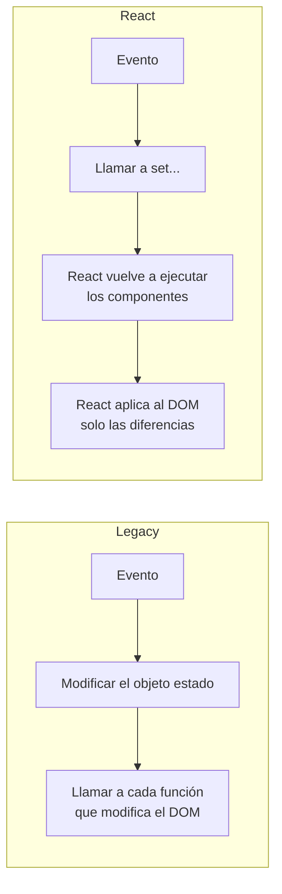

### 5.2 Dónde vive el estado

**En este proyecto (legacy)**, para conocer el estado completo hay que revisar el objeto `estado`, los valores de los campos del formulario, el atributo `hidden` del cuadro y el atributo `disabled` de los botones. La información está repartida entre JavaScript y el DOM, y deben mantenerse coherentes entre sí.

**En este proyecto (React)**, todo lo que influye en la pantalla está en variables de `useState`. El DOM es solo una consecuencia. Con React Developer Tools se puede ver todo el estado en un solo lugar.

Este es el concepto de **fuente única de verdad**: cuando un dato vive en un solo lugar, no puede contradecirse consigo mismo.

### 5.3 Organización del código: concentrado frente a componentes

Medición del proyecto (líneas de código sin comentarios ni líneas en blanco):

| Capa | Legacy | React |
|---|---|---|
| Reglas, mensajes y servicio | 4 archivos (mismo código en ambas versiones, salvo el modo de apertura local de legacy) | 4 archivos |
| Interfaz | 550 líneas en 3 archivos (`index.html` 137, `estudiantes.js` 229, `app.js` 184) | 638 líneas en 10 archivos (`EstudianteForm.jsx` 194, `App.jsx` 157, `useEstudiantes.js` 75, `EstudianteTable.jsx` 69, `ConfirmacionEliminar.jsx` 49, `EstudianteRow.jsx` 41, `BuscadorEstudiantes.jsx` 18, `MensajeEstado.jsx` 14, `index.html` 12, `main.jsx` 9) |

**Cómo interpretar estos datos.**

- **React no usó menos código en esta implementación.** Es un dato importante para evitar una idea frecuente y equivocada. Parte de la diferencia viene del formato: en JSX cada prop suele ocupar su propia línea.
- **La diferencia está en la distribución.** En legacy, la interfaz se concentra en dos archivos que se comunican mediante nombres globales y `id` del HTML. En React, cada archivo corresponde a una pieza visible de la pantalla y declara sus dependencias con `import` y props.
- La pregunta útil no es "¿cuál tiene menos líneas?", sino "**¿cuántos lugares hay que tocar para hacer un cambio, y qué tan fácil es saber cuáles son?**". La Actividad 6 está diseñada para responderla.

### 5.4 Reutilización

**En este proyecto**, `MensajeEstado` se reutiliza para el mensaje general y para los estados de la tabla. Legacy logra lo mismo con la función `crearElementoMensaje()`. Es decir, **reutilizar no es exclusivo de React**: las funciones también se reutilizan.

**En general**, la diferencia está en lo que se reutiliza. Una función de legacy genera elementos, pero su comportamiento depende de los `id` que existan en la página y de las variables globales. Un componente agrupa estructura, comportamiento y estado en una unidad que solo depende de sus props, y por eso se puede llevar a otra pantalla con menos riesgo.

### 5.5 Mantenibilidad

**Mantenibilidad** es la facilidad con que un sistema se puede modificar sin introducir errores. Depende de tres preguntas:

1. **¿Dónde está lo que hay que cambiar?** En legacy, un cambio en el formulario puede afectar a `index.html`, `estudiantes.js` y `app.js`. En React, a `EstudianteForm.jsx` y, como mucho, a `App.jsx`.
2. **¿Qué más se puede romper?** En legacy, cambiar un `id` rompe el JavaScript sin aviso, y cambiar el estado sin actualizar la pantalla deja la interfaz inconsistente. En React, las props hacen visibles las dependencias entre componentes.
3. **¿Cómo se comprueba?** En ambas versiones, las reglas se pueden probar de forma aislada porque son funciones puras. Probar la interfaz requiere un navegador en ambos casos.

**En este proyecto**, un cambio de validación se hace en un solo archivo por versión. Eso no se debe a React, sino a que las reglas se separaron de la interfaz.

### 5.6 Facilidad para incorporar funcionalidades

Al agregar una funcionalidad, el riesgo principal en legacy es olvidar alguna de las actualizaciones manuales que la nueva funcionalidad requiere en cada caso. En React, el riesgo se desplaza a otros lugares: decidir dónde vive el nuevo estado, qué componentes lo necesitan y cómo pasárselo. La Actividad 2 permite comparar ambas experiencias con un filtro por carrera.

### 5.7 Curva de aprendizaje

| | Legacy | React |
|---|---|---|
| Conocimientos previos | HTML, CSS, JavaScript, DOM, eventos, promesas | Todo lo anterior, más: módulos, JSX, componentes, props, estado inmutable, `useEffect` y sus dependencias, `key` |
| Herramientas | Navegador; un servidor web, o abrir el archivo con doble clic | Node.js, npm, Vite, carpeta `node_modules` |
| Depuración | El código que se ejecuta es el que se escribió | El JSX se transforma antes de ejecutarse; se necesitan React Developer Tools para ver el estado |

La curva de React es más empinada al principio porque se suma a la de JavaScript, no la sustituye.

### 5.8 Complejidad inicial y complejidad al crecer

**En este proyecto:** la versión legacy funciona con abrir un archivo. La versión React necesitó instalar 65 paquetes y usar un servidor de desarrollo que transforma el código.

**En general:** el esfuerzo de cada enfoque crece de forma distinta.

- En el enfoque imperativo, cada nuevo estado (un filtro, un permiso, un modo de edición) puede combinarse con los existentes. El número de situaciones que el código debe manejar a mano crece más rápido que el número de funcionalidades.
- En React, el costo inicial es mayor (herramientas y conceptos), pero cada componente sigue siendo una función de su estado y sus props, por compleja que sea la aplicación completa.

Por eso, para una página pequeña, React puede ser una carga innecesaria, mientras que en una aplicación con muchas pantallas y estados combinados suele compensar. Este proyecto es pequeño, así que no demuestra esta afirmación: solo permite empezar a observarla.

---

## Sección 6. Limitaciones y evolución

### 6.1 Por qué un archivo JSON no es un backend

**Idea central.** Un archivo JSON es **contenido estático**: el servidor lo entrega tal como está guardado en el disco. No ejecuta lógica, no valida, no recibe datos y no guarda cambios.

Una **API REST**, en cambio, es un programa que se ejecuta en el servidor. Organiza los datos como **recursos** (`/api/estudiantes`) y responde a las operaciones del protocolo HTTP:

| Verbo HTTP | Significado | Ejemplo |
|---|---|---|
| `GET` | Leer | `GET /api/estudiantes` devuelve la lista |
| `POST` | Crear | `POST /api/estudiantes` con los datos en el cuerpo |
| `PUT` | Reemplazar o actualizar | `PUT /api/estudiantes/5` |
| `DELETE` | Eliminar | `DELETE /api/estudiantes/5` |

El servidor responde con un **código de estado** que indica el resultado: `200 OK`, `201 Created`, `204 No Content` (éxito sin contenido), `400 Bad Request` (datos inválidos), `404 Not Found` o `500 Internal Server Error`.

### 6.2 Por qué los cambios no se conservan

**Archivo:** `legacy/js/servicios/estudiantesService.js`
```js
let estudiantesEnMemoria = null;
```

Esta variable hace el papel de la base de datos. Crear, editar y eliminar la modifican, pero vive en la memoria de la pestaña del navegador. Al recargar la página, el navegador descarta toda la memoria de JavaScript, la variable vuelve a `null` y los datos se leen de nuevo del archivo JSON original. Lo mismo ocurre en `react/src/services/estudiantesService.js`.

**Persistencia** significa que los datos sobreviven al cierre del programa. Se consigue guardándolos fuera de la memoria: en una base de datos administrada por el servidor.

### 6.3 Por qué la página funciona aunque se abra con doble clic

**Idea central.** Al abrir `legacy/index.html` con doble clic, la dirección empieza con `file://` en lugar de `http://`. Por seguridad, los navegadores **bloquean `fetch` sobre archivos locales**: si no lo hicieran, cualquier página guardada en el disco podría leer otros archivos del equipo.

Para que la práctica funcione también así, el servicio detecta ese caso y usa una copia de los datos que se carga con una etiqueta `<script>`, algo que los navegadores sí permiten:

**Archivo:** `legacy/js/servicios/estudiantesService.js`
```js
if (window.location.protocol === "file:") {
  console.warn(
    "Página abierta como archivo local (file://): se usan los datos de " +
      "datos/datos-locales.js. Use un servidor web para consultar los JSON con fetch."
  );
  return structuredClone(DATOS_LOCALES[nombreArchivo]);
}
```

`structuredClone` crea una copia profunda del objeto, de modo que cada consulta recibe datos independientes, igual que con una respuesta nueva de un servidor.

**Por qué esto no afecta a React.** La versión React siempre se ejecuta a través del servidor de desarrollo de Vite (`http://localhost:5173`), por lo que `fetch` siempre está disponible.

**Para la clase.** Es una buena ocasión para explicar que el navegador aplica reglas de seguridad según el **origen** de una página (protocolo, dominio y puerto). Esas mismas reglas explican el problema de CORS de la sección 6.5.

### 6.4 Las funciones del servicio ya tienen la forma de una API

| Función del servicio | Solicitud equivalente | Respuesta esperada |
|---|---|---|
| `obtenerCarreras()` | `GET /api/carreras` | `200` + lista de carreras |
| `obtenerEstudiantes()` | `GET /api/estudiantes` | `200` + lista de estudiantes |
| `crearEstudiante(datos)` | `POST /api/estudiantes` | `201` + estudiante con `id` |
| `actualizarEstudiante(id, datos)` | `PUT /api/estudiantes/{id}` | `200` + estudiante actualizado |
| `eliminarEstudiante(id)` | `DELETE /api/estudiantes/{id}` | `204` |

Como el resto de la aplicación solo conoce estas funciones, reemplazar la simulación por un servidor real solo cambia el **interior** del servicio. Este principio se llama **separación de responsabilidades** y es la razón por la que la capa de servicios existe desde el principio, aunque hoy solo lea archivos.

### 6.5 Cómo se reemplazaría la simulación por un backend Spring Boot

Fragmento **ilustrativo** de `crearEstudiante` consumiendo una API real:

```js
// Ilustrativo: versión futura de estudiantesService.js
async function crearEstudiante(datos) {
  const respuesta = await fetch(`${CONFIG_API.urlBase}/estudiantes`, {
    method: "POST",
    headers: { "Content-Type": "application/json" },
    body: JSON.stringify(datos),
  });
  if (!respuesta.ok) {
    throw new Error(`Error al crear el estudiante (HTTP ${respuesta.status}).`);
  }
  return respuesta.json();
}
```

Qué cambia respecto de la versión actual:

- `method: "POST"` indica la operación.
- `body: JSON.stringify(datos)` convierte el objeto en texto JSON para enviarlo.
- El encabezado `Content-Type` le indica al servidor cómo interpretar ese texto.
- `urlBase` apuntaría al servidor (por ejemplo, `http://localhost:8080/api`).

Lo que **no** cambia: `app.js` y `estudiantes.js` en legacy; `App.jsx`, el hook y los componentes en React.

**El backend en capas.** Una aplicación Spring Boot se organiza de forma análoga a nuestro frontend:

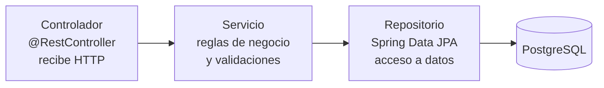

- El **controlador** traduce solicitudes HTTP en llamadas a métodos, y sus resultados en respuestas JSON con el código de estado adecuado.
- El **servicio** aplica las reglas: código único, correo válido, carrera existente. Son las mismas reglas de `validaciones.js`, y deben repetirse en el servidor porque cualquiera puede enviar una solicitud sin pasar por el formulario.
- El **repositorio** lee y escribe en la base de datos.

**CORS.** Si la aplicación React (`localhost:5173`) llama a una API en otro puerto (`localhost:8080`), el navegador la considera de otro **origen** y bloquea la respuesta, salvo que el servidor la autorice. Esa autorización se llama **CORS** (*Cross-Origin Resource Sharing*) y se configura en el backend.

### 6.6 Una API, varios clientes: React y Android

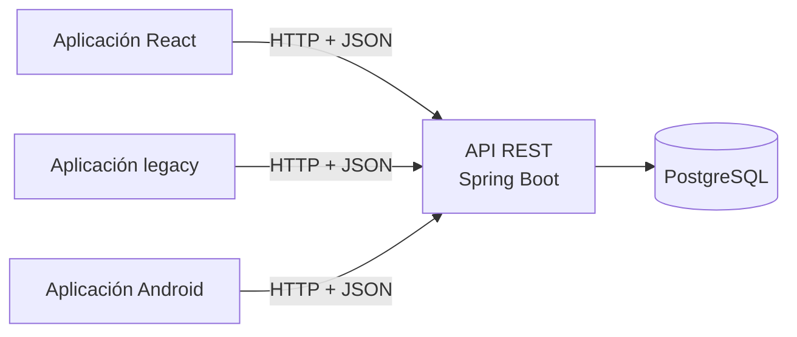

Una API que intercambia JSON por HTTP no sabe ni le importa qué tipo de cliente la consulta. Una aplicación Android (en Kotlin o Java) usaría un cliente HTTP, como Retrofit, con las mismas rutas. Así, las reglas de negocio y los datos quedan en un solo lugar, el backend, y cada cliente se ocupa solo de su interfaz. Por eso, en una arquitectura bien diseñada, cambiar de React a otra tecnología de interfaz no obliga a rehacer el backend.

### 6.7 El papel de PostgreSQL y del backend

- **PostgreSQL** es un sistema de base de datos relacional. Guardaría dos tablas, `carrera` y `estudiante`, con estas garantías:
  - una restricción `UNIQUE` sobre `codigo`, de modo que la base de datos rechace duplicados aunque el código de la aplicación falle;
  - una **clave foránea** `carrera_id`, que impide asignar una carrera inexistente.
- **El backend** asigna los `id`, aplica las reglas, controla quién puede hacer cada operación y traduce entre HTTP y la base de datos.
- **El frontend**, legacy o React, presenta la información y captura las acciones del usuario.

Cada capa protege los datos a su nivel. El frontend valida para dar respuestas rápidas al usuario, el backend para garantizar las reglas y la base de datos para garantizar la integridad.

---

## Sección 7. Actividades de laboratorio

Cada actividad se realiza en **ambas** versiones. El objetivo no es solo completar el cambio, sino **observar** cómo lo resuelve cada enfoque. Antes de empezar, registre la hora; al terminar, anote los archivos modificados y las dificultades encontradas.

### Actividad 1. Agregar el campo `fechaNacimiento`

**Objetivo.** Descubrir cuántos lugares del código conocen la lista de campos de un estudiante.

**Indicaciones.** Agregue el campo al formulario y a los datos de prueba. Antes de programar, intente predecir qué archivos tendrá que modificar en cada versión. Luego compare su predicción con lo que realmente modificó.

**Pistas, si se detiene.**

- En legacy, el campo debe existir en el HTML y en la lista `CAMPOS_FORMULARIO` de `estudiantes.js`. ¿Qué pasa si solo lo agrega al HTML?
- En React, piense en los valores iniciales del formulario (`FORMULARIO_VACIO` y `crearDatosIniciales`).
- En ambas, `limpiarDatosEstudiante` decide qué datos llegan al servicio.

**Preguntas para reflexionar.**

1. ¿En qué versión fue más fácil olvidar un paso? ¿Cómo se manifestó el olvido?
2. ¿Hubo archivos que tuvo que modificar en ambas versiones? ¿Por qué esos?

### Actividad 2. Filtrar por carrera

**Objetivo.** Comparar cómo cada enfoque combina dos criterios de filtro (texto y carrera).

**Indicaciones.** Agregue un `<select>` con las carreras y la opción "Todas", junto al buscador. La tabla y el contador deben respetar ambos filtros a la vez.

**Qué observar.**

- **En legacy:** ¿cuántas piezas necesita conectar? Piense en el elemento HTML, la referencia en `dom`, el nuevo dato en `estado`, el evento y el cálculo en `actualizarTabla`. ¿El filtro se mantiene después de registrar o eliminar a un estudiante? ¿Por qué?
- **En React:** ¿dónde debe vivir el estado del filtro para que la tabla lo conozca? ¿Qué hizo falta para que el contador se actualizara?

### Actividad 3. Correo único

**Objetivo.** Comprobar el valor de separar las reglas de la interfaz.

**Indicaciones.** Agregue a `validarEstudiante` una regla que impida repetir un correo, con su mensaje en `MENSAJES_VALIDACION`.

**Casos que debe comprobar:**

1. Registrar a alguien con `ana.lopez@example.com` debe mostrar el error.
2. Editar a `EST-0002` y poner el correo de `EST-0001` debe mostrar el error.
3. Editar a `EST-0001` y guardar sin cambios **no** debe mostrar error.

**Pregunta para reflexionar.** El tercer caso falla si se olvida un detalle. ¿Cuál? Pista: ¿cómo se resolvió el mismo problema para el código del estudiante?

### Actividad 4. La espera de la red

**Objetivo.** Entender qué ocurre mientras una aplicación espera datos.

**Indicaciones.** Abra ambas versiones con `?demora=2000`, o cambie `demoraMs` en `CONFIG_API`.

**Preguntas para reflexionar.**

1. ¿Qué ve el usuario durante la espera? ¿Qué podría hacer mal si no hubiera indicador ni bloqueo?
2. En F12 > Red, ¿cuántas solicitudes hace cada versión? ¿Por qué React, en desarrollo, hace el doble? (sección 3.7)
3. Mientras se guarda un registro, ¿se pueden pulsar los botones Editar y Eliminar? ¿Por qué se decidió impedirlo?

### Actividad 5. La persistencia

**Objetivo.** Comprender la diferencia entre memoria y almacenamiento persistente.

**Indicaciones.** Registre un estudiante y recargue la página con F5.

**Preguntas para reflexionar.**

1. ¿Por qué desaparece? Explíquelo con referencia a `estudiantesEnMemoria`.
2. ¿Qué solicitud HTTP debería enviar `crearEstudiante` para conservar el cambio? ¿Qué debería responder el servidor?
3. ¿Qué tres responsabilidades asumiría el backend que hoy nadie cumple?

### Actividad 6. Comparar el mantenimiento

**Objetivo.** Medir, en lugar de suponer, el esfuerzo de mantener cada versión.

**Cambio solicitado:** mostrar el teléfono como columna de la tabla y escribir "Sin teléfono" cuando esté vacío.

| Criterio | Legacy | React |
|---|---|---|
| Archivos modificados | | |
| Funciones o componentes afectados | | |
| Lógica que tuvo que repetir | | |
| Funcionalidades que podrían haberse afectado | | |
| Cómo comprobó que funciona | | |
| Tiempo empleado | | |

**Advertencia.** No hay una respuesta esperada. Es posible que, para este cambio, la diferencia sea pequeña. La conclusión debe basarse en lo que registró, no en lo que se dice de cada tecnología.

---

## Sección 8. Conclusiones

1. **El mismo problema admite soluciones distintas.** Las dos aplicaciones son equivalentes para el usuario. La diferencia está en la forma de organizar y mantener el código, no en el resultado.
2. **La idea central es la sincronización.** En legacy, el programador mantiene la pantalla de acuerdo con los datos instrucción por instrucción. En React, la pantalla es una consecuencia del estado.
3. **Una buena arquitectura no depende de la tecnología.** Separar reglas, datos e interfaz permitió reutilizar el mismo código de negocio en ambos enfoques. Esa decisión hará posible conectar un backend sin rehacer las interfaces.
4. **React tiene costos reales.** En este proyecto no redujo las líneas de código y añadió herramientas y conceptos que hay que aprender. Sus ventajas aparecen en la consistencia de la interfaz y en la organización por componentes, y se notan más cuanto más crece la aplicación.
5. **JavaScript tradicional sigue siendo indispensable.** Los eventos, `fetch`, las promesas, `async/await`, los métodos de arreglos (`map`, `filter`, `some`), el DOM y la accesibilidad son los mismos en ambos enfoques. Cuando algo falla en React, son estos conocimientos los que permiten entender por qué.
6. **React no reemplaza a HTML, CSS ni JavaScript.** Es una forma de organizarlos. Elegir entre un enfoque y otro depende del tamaño de la aplicación, del equipo y de cuánto debe evolucionar.

**Pregunta de cierre.** Si este módulo creciera con matrícula de cursos, calificaciones y permisos por rol, ¿qué partes de cada versión habría que modificar? ¿En cuál le preocuparía más introducir errores, y por qué?

---

## Anexo A. Demostraciones en vivo

| # | Demostración | Cómo hacerla | Concepto que ilustra |
|---|---|---|---|
| D1 | Equivalencia | Abrir ambas aplicaciones lado a lado y repetir el mismo registro. | Mismo resultado, distinta implementación. |
| D2 | Actualización imperativa | En legacy, F12 > Elementos; escribir en el buscador. | Todo el `<tbody>` se reemplaza en cada pulsación. |
| D3 | Estado en React | React Developer Tools > `App`; escribir en el buscador y pulsar Editar. | La interfaz sigue a `textoBusqueda` y a `idEnEdicion`. |
| D4 | Estado de carga | `?demora=2000` en ambas. | Indicador de carga y bloqueo del formulario. |
| D5 | Manejo de errores | `?error=1` en ambas; revisar la consola; pulsar Reintentar. | Mensaje para el usuario y detalle técnico para el programador. |
| D6 | Persistencia | Registrar un estudiante y pulsar F5. | Diferencia entre memoria y base de datos. |
| D7 | Importancia de `key` | En `EstudianteTable.jsx`, borrar temporalmente `key={estudiante.id}` y abrir la consola. | React advierte "Each child in a list should have a unique key prop". Restablecer la línea al terminar. |
| D8 | Orden de los scripts | En `legacy/index.html`, mover `estudiantes.js` al final y recargar; luego probar con `utilidades.js`. | El ámbito global, la dependencia del orden de carga y los errores que dependen del momento de ejecución. Restablecer el orden al terminar. |
| D9 | Protección contra XSS | Registrar el nombre `<b>Ana</b>` en ambas. | `textContent` y el escape automático de React. |
| D10 | Abrir con doble clic | Abrir `legacy/index.html` desde el explorador de archivos y revisar la consola. | Reglas de seguridad del navegador para `file://`. |

## Anexo B. Glosario

| Término | Definición |
|---|---|
| API REST | Programa en un servidor que expone recursos mediante URL y verbos HTTP, y responde normalmente con JSON. |
| Asíncrono | Operación que se inicia y cuyo resultado llega más tarde, sin detener el programa. |
| Backend | Parte de una aplicación que se ejecuta en el servidor: datos, reglas y seguridad. |
| Componente | En React, función que recibe props y devuelve la descripción de una parte de la interfaz. |
| CORS | Mecanismo con el que un servidor autoriza que páginas de otro origen lean sus respuestas. |
| Declarativo | Estilo en el que se describe el resultado deseado y otro mecanismo calcula los pasos. |
| Delegación de eventos | Registrar un único manejador en un elemento padre para atender eventos de sus hijos. |
| DOM | Representación en memoria de la página como árbol de objetos que JavaScript puede modificar. |
| Efecto | En React, código que se ejecuta después del renderizado para sincronizarse con algo externo. |
| Estado | Datos que determinan lo que se muestra en un momento dado. |
| Estado derivado | Valor que se calcula a partir del estado en lugar de guardarse por separado. |
| `fetch` | Función del navegador para hacer solicitudes HTTP; devuelve una promesa. |
| Frontend | Parte de una aplicación que se ejecuta en el navegador. |
| Hook | Función de React cuyo nombre empieza con `use` (`useState`, `useEffect`) y permite usar estado u otras capacidades en un componente. |
| Imperativo | Estilo en el que se indican los pasos uno por uno. |
| Inmutabilidad | Práctica de crear valores nuevos en lugar de modificar los existentes. |
| JSON | Formato de texto para representar datos estructurados. |
| JSX | Sintaxis que permite describir interfaces con aspecto de HTML dentro de JavaScript. |
| `key` | Prop especial que identifica a un elemento entre renderizados. |
| Módulo ES | Archivo de JavaScript con ámbito propio, que comparte valores mediante `import` y `export`. |
| Persistencia | Capacidad de los datos de sobrevivir al cierre de la aplicación. |
| Promesa | Objeto que representa un resultado futuro: pendiente, cumplido o rechazado. |
| Propagación | Recorrido de un evento desde el elemento donde ocurrió hacia sus ancestros. |
| Props | Parámetros que un componente recibe de su padre; el hijo no los modifica. |
| Reconciliación | Proceso con el que React compara la descripción nueva con la anterior y actualiza solo lo que cambió. |
| Renderizado | En React, ejecución de un componente para obtener la descripción de la interfaz. |
| XSS | Ataque que consiste en hacer que una página ejecute código inyectado a través de datos. |
